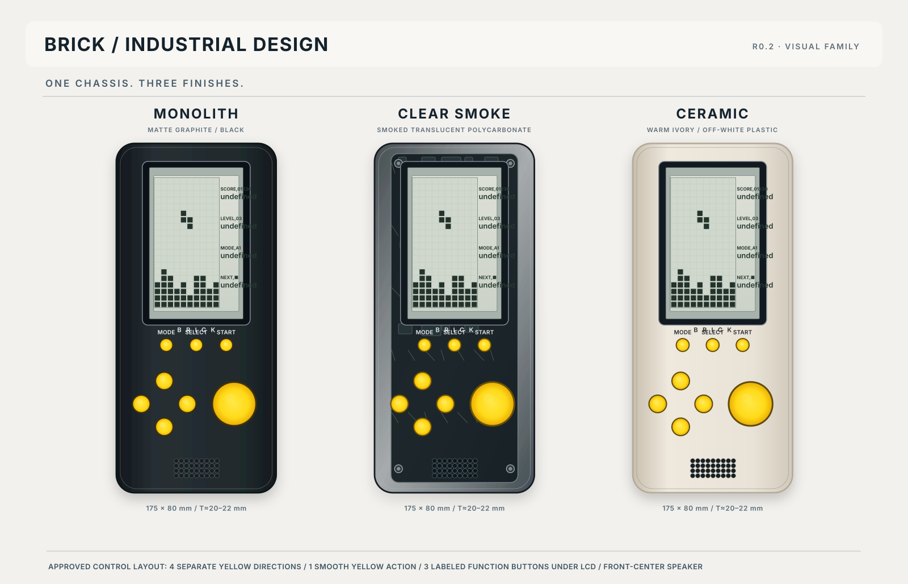
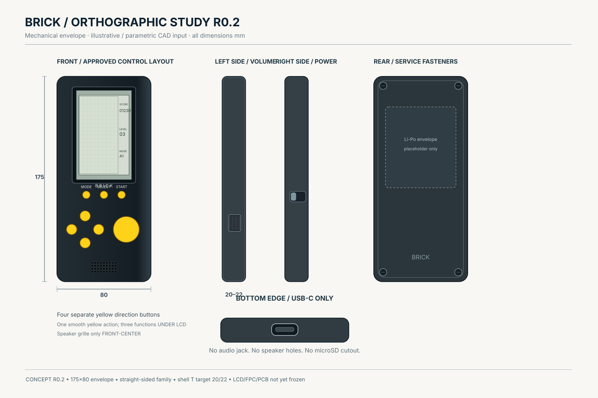
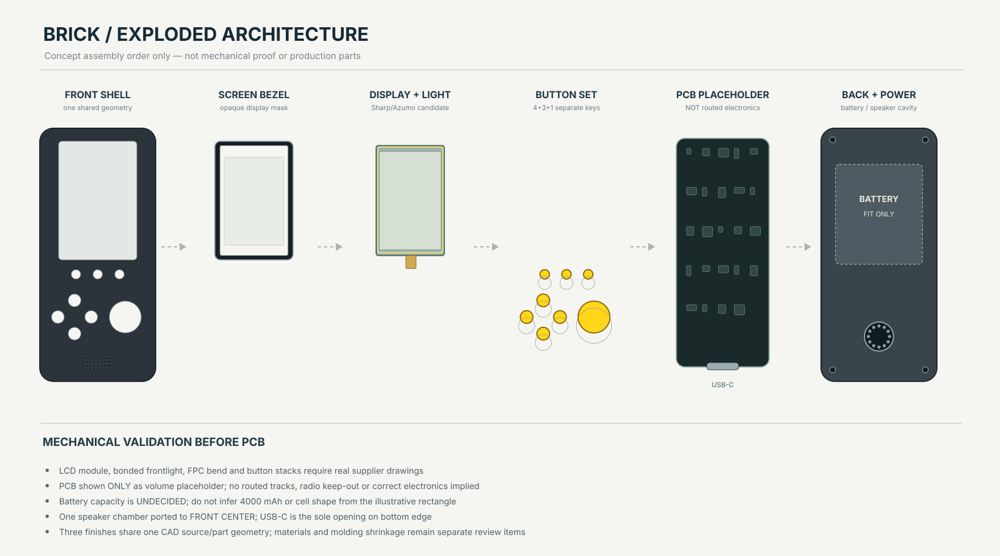

# Brick — premium handheld Brick Game

**Status:** concept / pre-prototype; **first software prototype added** (portable game core, base Tetris, menu — see below). **Visibility:** private. **Documentation language:** Russian.

An original, premium, rechargeable handheld inspired by classic vertical Brick Game devices. The project emphasizes authentic strictly monochrome pixel graphics, physical controls, high-quality sound, long battery life and upgradeable firmware — without emulating a general-purpose game console.

> [!IMPORTANT]
> This repository is at requirements/discovery stage. No processor, LCD panel, battery, radio-audio profile, PCB or enclosure dimension is approved for manufacture. See `docs/PRODUCT_REQUIREMENTS.md` and `docs/HARDWARE_RESEARCH.md`.

## Confirmed product direction

- Large recognizable **classic Brick Game silhouette**; elegant contemporary execution, not a mini handheld.
- **CONFIRMED positive monochrome LCD appearance:** dark/black pixels on a light neutral-gray reflective background, legible without powered illumination in adequate ambient light; optional subtle **white illumination** only for darkness. No reverse/negative LCD theme, greyscale or color UI required. Panel technology and illuminator are still unselected.
- **Four separate small yellow round directional buttons**, **one large smooth yellow action button**, and **three labeled yellow function buttons directly BELOW the LCD (MODE / SELECT / START)**, plus physical power and volume wheel/slider.
- USB-C **centered on the bottom as its only opening**, no 3.5 mm audio jack; **single speaker grille on FRONT near bottom center**. **BLE is required for phone connection, settings and synchronization. All audio is through the built-in speaker; Bluetooth headphones are not supported or required.**
- Target **20–30 hours** runtime under a precisely defined test profile; rechargeable battery.
- Launch with approximately **10 classic games**, extend through firmware updates.
- Reuse game rules and regression fixtures from [grayhex/ApolloBrickGames](https://github.com/grayhex/ApolloBrickGames); do not assume its browser/TypeScript code runs unmodified on an MCU.
- Initial manufacturing volume: **100–500 units**. Repository stays private for now.

## Программный прототип (0.1)

Переносимое игровое ядро на C11, не привязанное к дисплею, разрешению, MCU или плате (ADR-023…033):

- **Ядро** `firmware/`: игра = POD-структура с таблицей функций, фиксированный такт 60 Гц, детерминированный ГСЧ, нет кучи и глобального состояния; граница с железом — `bk_hal_t` (ввод, дисплей, звук, хранилище, подсветка).
- **Tetris, базовый вариант 01**, перенесён из [ApolloBrickGames](https://github.com/grayhex/ApolloBrickGames) и **сверяется с эталоном на каждом такте**: 68 сценариев, 59 357 тактов ([docs/CONFORMANCE.md](docs/CONFORMANCE.md)). Остальные 50 вариантов не нужны на этом этапе ([docs/GAME_TETRIS.md](docs/GAME_TETRIS.md)); **ПК-симулятор** (терминал и браузер, ядро как WebAssembly) — [docs/SIMULATOR.md](docs/SIMULATOR.md).
- **Snake, варианты 01 и 02 («FRAME»)**, вторая игра на общей основе (жизни, сцены очистки поля): сверка с эталоном на каждом такте, **72 сценария, 84 588 тактов**; правила «FRAME», 13 плодов и +100 — реконструкция и адаптация самого эталона ([docs/GAME_SNAKE.md](docs/GAME_SNAKE.md)). Игры выбираются в меню клавишами влево/вправо.
- **Экран:** 1-битный логический кадр, позитивная полярность, поле 10×20 + статус-колонка справа; эталонная сетка и **подгонка под нативный размер панели** (клетка 26 точек и колонка 76 точек для 336×536), ограничитель частоты показа `max_fps` — 60 Гц это частота симуляции, не панели ([docs/UI_MENU.md](docs/UI_MENU.md)).
- **Меню:** номер/буква игры, номер режима, миниатюра, SPEED/LEVEL, настройки; четыре кнопки направлений, одна кнопка действия и кнопки MODE / SELECT / START (физический набор подтверждён PRD).
- Размер ядра с двумя играми под Cortex-M4F: ≈ 26,8 КБ flash (26 778 Б), `.data = .bss = 0` (**только компиляция**, на железе не измерялось).

```sh
cmake -S . -B build -G Ninja && cmake --build build && ctest --test-dir build --output-on-failure
cmake -S . -B build-asan -G Ninja -DBRICK_SANITIZE=ON && cmake --build build-asan && ctest --test-dir build-asan   # ASan + UBSan
cmake -S . -B build-m4 -G Ninja -DCMAKE_TOOLCHAIN_FILE=cmake/arm-none-eabi.cmake -DCMAKE_BUILD_TYPE=Release -DBRICK_BUILD_TESTS=OFF \
  && cmake --build build-m4 && cmake --build build-m4 --target brickcore_size                                       # проверка переносимости
```

Нужны CMake ≥ 3.16 и компилятор C11/C++17; Node ≥ 20 — только для регенерации фикстур соответствия.

## Documentation

- [Product requirements](docs/PRODUCT_REQUIREMENTS.md) — authoritative confirmed requirements vs open choices.
- [Hardware research and decision gates](docs/HARDWARE_RESEARCH.md) — LCD, SoC, battery, BLE, sound, production, provisional BOM.
- [Display shortlist and physical pixel fit](docs/DISPLAY_CANDIDATES.md) — concrete Sharp MIP displays, Azumo frontlight, 10×20+right-side HUD fit, sourcing risks.
- [Enclosure R0.2 concept](docs/MECHANICAL_CONCEPT.md) — preferred classic straight-sided silhouette, 175×80 mm, proposed 20–22 mm thickness, corrected 8 buttons and front speaker.
- [Roadmap](docs/ROADMAP.md) — gates instead of dates, tracks, decisions owed by the owner, nearest software backlog.
- [Game candidates](docs/GAME_CANDIDATES.md) — inventory of the ApolloBrickGames shortlist (size, fidelity, buttons), recommended porting order.
- [PC simulator](docs/SIMULATOR.md) — the firmware core in a terminal and in a browser (WebAssembly): menus, controls, native-size LCD, panel refresh limit, session record/replay.
- [First CAD mockup review](docs/MECHANICAL_MOCKUP_REVIEW.md) — measured STL mockup (buildcad.ai) against R0.2: what matches, 14 open items (button pitch, window, USB-C opening, side controls); archive in `mechanical/inbox/`, tool in `tools/cad_review/`.
- [CAD agent handoff prompt](docs/CAD_HANDOFF_PROMPT.md) — ready-to-use editable parametric CAD task, part hierarchy, fit checks, STEP/STL exports.
- [R0.2 three finish variants](design/concepts/brick-family-r02.svg) · [orthographic views](design/concepts/brick-orthographic-r02.svg) · [exploded concept](design/concepts/brick-exploded-r02.svg) — new SVG images with **current** controls.
- [Older R0.1 drawing](design/brick-envelope-r01.svg) — **ARCHIVED**, not the approved button placement.
- [Game portability plan](docs/GAME_PORTING.md) — factual source mapping and safe migration.
- [Decision log](docs/DECISIONS.md) — status and rationale.
- [Архитектура прошивки](docs/FIRMWARE_ARCHITECTURE.md) — слои, HAL, память, порт на ARM MCU, как добавить игру.
- [Tetris: что портировано](docs/GAME_TETRIS.md), [Snake: что портировано](docs/GAME_SNAKE.md), [соответствие эталону](docs/CONFORMANCE.md), [меню и управление](docs/UI_MENU.md).
- [Сторонние материалы](THIRD_PARTY.md) — происхождение и лицензии.
- [Software ↔ hardware review, 2026-10-20](docs/ENGINEERING_REVIEW_2026-10-20.md) — confirmed matches, remaining compatibility and hardware validation risks.
- [Parametric CAD workflow](docs/CAD_WORKFLOW.md) — suggested CadQuery + GitHub Actions + local FreeCAD inspection; private Onshape alternative.
- [Agent instructions](AGENTS.md) — constraints and first execution steps.

## Visual reference — Brick R0.2

The following pictures are **vector concept drawings**, not photorealistic renderings or fabrication CAD. They encode the corrected controls and are kept directly in this repository. The user's preferred **original photorealistic triptych** sets the proportions and silhouette; its older D-pad / low function buttons / side-bottom speaker holes are superseded by R0.2 requirements.

**Preferred original silhouette:** [locally archived JPG thumbnail](design/reference-original/preferred-render-thumb.jpg) ([reference notes](design/reference-original/README.md)). The complete high-resolution source PNG still needs binary upload; this archived thumbnail is only 150×137 px.








**Use for CAD:** [docs/CAD_HANDOFF_PROMPT.md](docs/CAD_HANDOFF_PROMPT.md). Do not infer real PCB routing, RF design, battery capacity, speaker acoustics, or FPC geometry from these visualizations.

## Repository layout

```text
brick/
├── README.md, AGENTS.md, THIRD_PARTY.md
├── CMakeLists.txt, cmake/        # host build and the Cortex-M4F cross-compile smoke test
├── docs/                         # requirements, research, decisions, display, mechanics, firmware architecture, UI, conformance
│   └── img/                      # illustrations of the logical frame (generated from tests/golden)
├── design/                       # concept SVG images, original-photo thumbnail and source-reference notes (mechanical R0.2)
├── firmware/                     # portable core (no board, no display, no MCU)
│   ├── include/brick/            # public API: game, hal, console, render, audio, save, ...
│   ├── core/                     # game base, input, rng, frame, font, render, audio, save, console
│   ├── games/tetris/             # base Tetris variant
│   ├── games/snake/              # Snake, variants 01 and 02 (FRAME)
│   └── catalog/                  # the games the product ships, in menu order
├── platform/sim/                 # PC simulator: window-less driver, terminal and WebAssembly front-ends
├── tests/                        # unit, conformance (recorded reference traces), golden screens, simulator sessions
│   ├── fixtures/{tetris,snake}/  # traces exported from the TypeScript reference
│   └── golden/                   # ASCII pictures of every console screen
├── tools/
│   ├── conformance/              # exporter of reference fixtures (Node, only for regeneration)
│   ├── frames/                   # golden frame -> PNG
│   ├── cad_review/               # measure the STL mockup against R0.2 (Python, numpy, Pillow)
│   ├── sim/                      # writes the simulator session fixtures
│   └── experiments/              # reproducible experiments behind ADRs
├── hardware/        # (planned) KiCad schematic, PCB, BOM and fabrication outputs
├── mechanical/      # inbox/ — archived first mockup (STL); (planned) CAD, enclosure, buttons, STEP
└── manufacturing/   # (planned) assembly/test instructions, DFM, QA
```

Directories marked *(planned)* do not exist until implementation begins. PCB work has not started.

## Immediate priorities

1. Validate two monochrome reflective-display families **with physical samples**, including white illumination and visibility with light off.
2. Prototype BLE connection to phone for configuration and sync; no wireless audio streaming.
3. Select 10 launch games and map their controls; check whether one action button is sufficient for every game.
4. Benchmark prospective MCU + LCD + audio power consumption and frame update latency.
5. Use current R0.2 drawings + CAD handoff to prototype ergonomics/acoustics **before** defining PCB outline and ordering tooling.

No FPGA is justified solely by classic Brick Game mechanics; assess it only if hardware-faithful reproduction becomes an explicit separate requirement.
