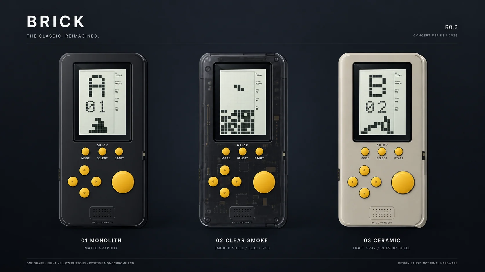
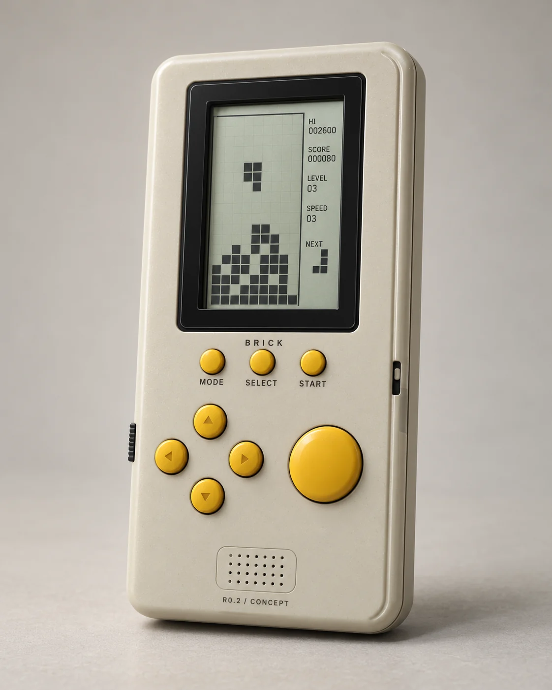
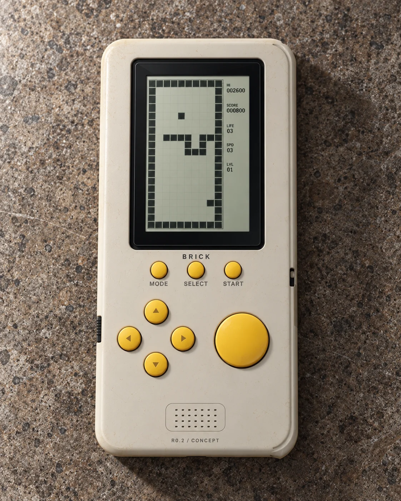
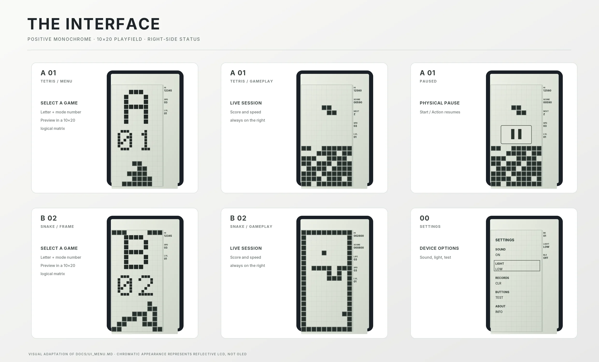

# BRICK R0.2 — render gallery and UI mockups

**Status:** industrial-design visual studies, **not** physical photographs, validated hardware CAD, manufactured prototypes, PCB designs, display optical measurements or accurate firmware captures. Added 2026-10-20.

## Updated appearance — three finishes

The shared tall classic Brick Game enclosure remains approximately **175 × 80 mm** (working design envelope). The three finishes use the *same* provisional geometry and eight yellow front buttons.

- **MONOLITH:** matte graphite, near-black.
- **CLEAR SMOKE:** translucent smoked plastic with **illustrative** black-PCB impression (not real component placement).
- **CERAMIC:** original Brick Game-inspired **warm light gray / beige-gray plastic** (rather than bright ivory or white). “Ceramic” is a finish name: the shell is plastic, not real ceramic.

Color reference: an owner-provided photograph of a classic Brick Game E-23. Shell tone is an artistic approximation; no spectrophotometer/real sample validation has taken place. No original game photo is embedded in this gallery.

## New photorealistic concept images

| Image | Intent |
| --- | --- |
| [Light gray — studio three-quarter view](brick-classic-gray-studio.webp) | Material, side edge, buttons, bezel, LCD in neutral studio light |
| [Light gray — tabletop top view](brick-classic-gray-tabletop.webp) | Classic handheld character, approximate face proportions and surface texture |
| [Three finishes — product family](brick-family-classic-gray.webp) | Consistent shared concept in matte black / smoke / warm gray |

## Earlier concept studies, repackaged as WebP

- [MONOLITH detail](brick-monolith-detail.webp)
- [CLEAR SMOKE detail](brick-clear-smoke-detail.webp)
- [Screen / menu overview](brick-ui-overview.webp)
- [Orthographic illustration](brick-orthographic-concept.webp)

## Interface explorations (individual screens)

| Tetris | Settings |
| --- | --- |
| [Menu](ui-tetris-menu.webp) | [Settings](ui-settings.webp) |
| [Gameplay](ui-tetris-play.webp) | |
| [Pause](ui-tetris-pause.webp) | |

The two Snake mock-ups of the earlier gallery (menu with variant "B 02" and gameplay inside a frame) were removed on 2026-10-20: they showed the "FRAME" variant, and games have no variants (ADR-036). Current Snake screens are generated from the firmware: [docs/img/home_snake.png](../../docs/img/home_snake.png), [docs/img/game_snake.png](../../docs/img/game_snake.png).

## What is authoritative

1. **Hardware/control requirements:** [Product Requirements](../../docs/PRODUCT_REQUIREMENTS.md) and [Mechanical Concept R0.2](../../docs/MECHANICAL_CONCEPT.md). Every render is subordinate to those documents. Specifically: four separate small yellow direction buttons, one large smooth yellow action button, MODE / SELECT / START immediately under the LCD, front-center single speaker grille, USB-C only on bottom.
2. **Logical UI:** [UI_MENU.md](../../docs/UI_MENU.md) and firmware golden frames in `tests/golden/`. The pictures here are design illustrations: labels, actual status values, screenshots and panel pixel-fit may differ from golden frames.
3. **Manufacturing / CAD:** [CAD handoff](../../docs/CAD_HANDOFF_PROMPT.md) and [CAD review](../../docs/MECHANICAL_MOCKUP_REVIEW.md). The photorealistic pictures are not dimensioned projections; the transparent PCB is hypothetical; the LCD / battery / speaker / RF stack and 20–30 h runtime are unverified. Do not build tooling or locate components based on these pictures.

Source artwork: generated concept images and vector studies during the owner's product-design discussion, October 2026. Optimized WebP exports preserve original image dimensions and are intended for repository browsing. Historical editable engineering SVGs remain in [design/concepts](../concepts).
