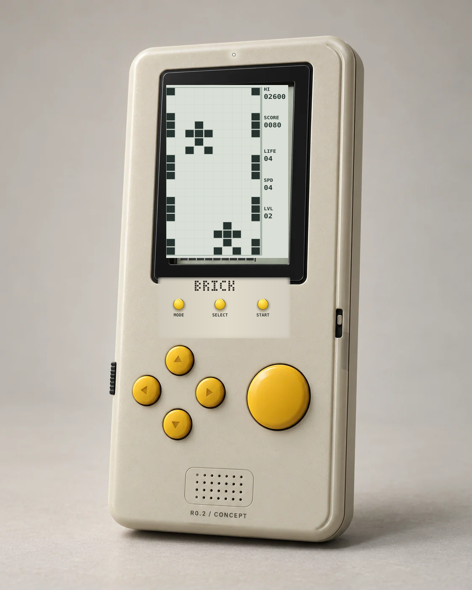
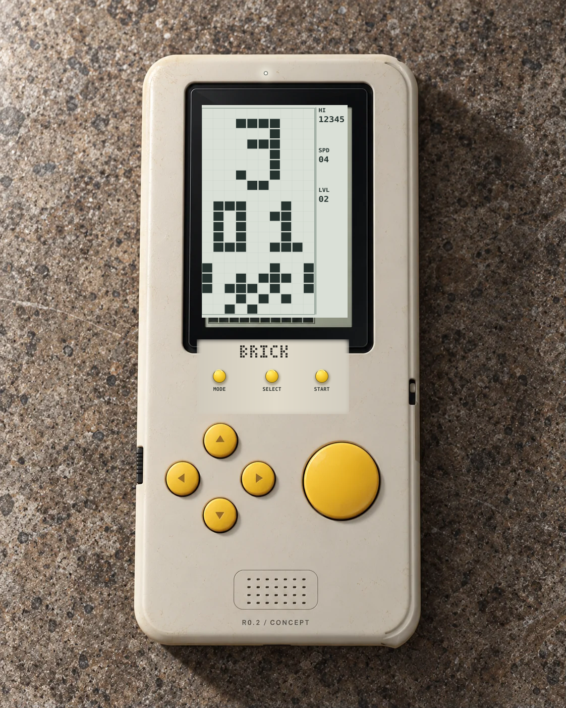

# BRICK — маркетинговые концепты R0.3

Статус: **визуальный дизайн; не CAD/PCB, не реальные фотографии, не экранная выгрузка с железа**. 2026-10-20.

В качестве исходника используются предыдущие фотореалистичные WebP из `design/renders/`; в двух переносимых SVG они встроены внутрь и дополнены корректирующей векторной графикой. Поэтому это **фотокомпозиции**, а не свежая съёмка устройства. Иллюстрации экрана ориентируются на `docs/UI_MENU.md` и `docs/GAME_RACING.md`, но **не являются golden frames прошивки**.

## Изменения по указанию владельца

- **MODE / SELECT / START:** три круглые жёлтые функциональные кнопки строго под LCD; видимо меньшего диаметра, чем в R0.2. В качестве отправной точки для CAD/эргономики исследовать **Ø4.5–5 мм** вместо предыдущих Ø6.5 мм. Не считать диаметр утверждённым без макета 1:1 и проверки хода/усилия.
- **Логотип BRICK:** увеличить; монохромная минималистичная **пиксельная** отливка/печать непосредственно под экраном. Проверить изготовление и читаемость.
- **Тактильность:** сдержанная отформовка символов на отдельных круглых кнопках направлений и тонкое сопряжение торцевых ободков. **ACTION остаётся гладкой и без глифа**.
- **Индикатор:** одна компактная точка **тёпло-нейтрального белого** света строго над окном LCD. Не трактовать её как вторую подсветку LCD. Назначение (питание, заряд, статус BLE), схемотехника, яркость, рассеиватель, ток и управление сном ещё открыты; не считать доказанным достижение 20–30 ч при его работе. В фото-интерпретации LED горит еле заметно.
- **Корпус:** сохраняется высокий почти прямой силуэт **175×80 мм**; CERAMIC — классический светлый тёплый серо-бежевый пластик, не чисто белый.
- **LCD:** позитивный, строго 1-bit: чёрные пиксели на светло-сером фоне; поле **10×20** и панель **справа**. Меню для Racing — номер **3**, один режим **01**, пиксельный клип 10×5; Racing — 2 полосы, машина **3×4 клетки**, 4 жизни, SPD / LVL. Никаких негативных OLED-тем/цветов.

Референсы: `docs/UI_MENU.md`, `docs/GAME_RACING.md`, `docs/PRODUCT_REQUIREMENTS.md`, `docs/MECHANICAL_CONCEPT.md`. Экран и физическая оптика панели не верифицированы. R0.2 `design/concepts/` остаётся размерной базой, не редактировался этой задачей. Маркетинговая концепция создана с использованием графических материалов текущего репозитория, а не новых CAD-экспортов.
