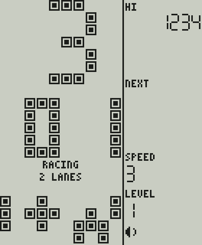
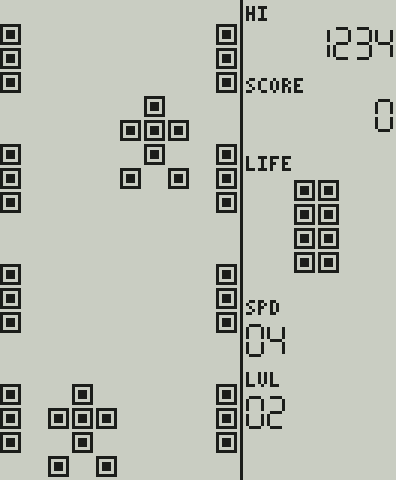
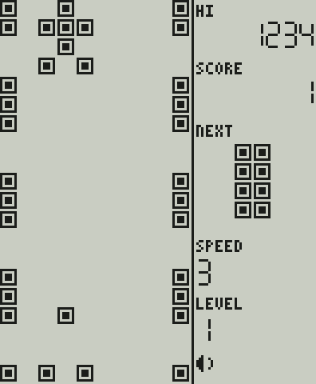

# Racing: что портировано из ApolloBrickGames

**Источник:** [grayhex/ApolloBrickGames](https://github.com/grayhex/ApolloBrickGames), коммит `abd7c3426f28222b54db2fe280597d7578e7191c`, файлы `src/brick/games/racing.ts`, `racing/base.ts`, `racing/road.ts`, `src/brick/base.ts` (жизни, добавочные жизни, взрыв, очистка), `src/brick/timing.ts`, `src/brick/rng.ts`, `src/core/rng.ts`; описание — `docs/brick/racing.md` эталона. Правила эталон взял у `RacingGame` проекта n0Live/BrickGame (MIT, [THIRD_PARTY.md](../THIRD_PARTY.md)).
**Реализация:** `firmware/games/racing/`, C11, поверх общей основы игры ([FIRMWARE_ARCHITECTURE.md §4](FIRMWARE_ARCHITECTURE.md)). **Один вариант** (ADR-036), решение о составе — ADR-040.

> **Достоверность: реконструкция по донору, НЕ ROM.** Эталон прямо пишет, что точных правил «Гонок» именно этой модели Apollo у него нет: игра 3 — перенос `RacingGame` донора, на проверенное исполнение оригинального кода она не опирается. Побитовое совпадение нашего порта с эталоном доказано на каждом такте ([CONFORMANCE.md](CONFORMANCE.md)); с настоящим устройством не сверялось и сверяться не с чем.

## 1. Объём порта

| | |
| --- | --- |
| Портировано | Вариант «две полосы» (тип 1 донора, обычное поле) |
| Не портировано | Три полосы (тип 2), оба варианта вверх ногами (типы 3 и 4) — решение владельца: один вариант (ADR-036); вместе с тремя полосами не нужны и «двойные» и «сдвинутые» группы машин с шансом `10 + уровень` %. «Гонки со стрельбой» (`racing-shoot`) в первую версию не входят |
| Идентификатор | `uid` 3 (в сохранениях не меняется), `id` `racing`, название «RACING» (в данных игры), в меню знак «3» и клип из 30 кадров (ADR-041) |

## 2. Правила и их основание

Всё ниже — правила донора в изложении эталона; проверено нами только совпадение с эталоном.

| Правило | Значение |
| --- | --- |
| Машина | три клетки в ширину, четыре в высоту: нос, перекладина, стойка, колёса; колёса стоят в нижнем ряду поля |
| Полосы | две, центры в колонках 3 и 6; старт на правой полосе (колонка 6); рамка дороги по обеим сторонам: три клетки горят, две нет, период пять, сдвигается на каждом шаге дороги |
| Встречные машины | того же вида, появляются группами над полем; расстояние между группами от 10 клеток на уровне 1 до 5 на уровне 10 (`10 − ⌊уровень / 2⌋`) плюс 0…2 случайных; полоса случайная |
| Шаг дороги | рамка двигается на каждом шаге, машины — на каждом втором; период шага по скорости и уровню: `200 − 5·уровень` мс на скорости 1 и `50 − уровень + 1` мс на скорости 10, линейно между ними, пополам, затем в такты 60 Гц с округлением как в эталоне (таблица 10 × 10 сверяется **точным равенством**) |
| Смена полосы | ВЛЕВО / ВПРАВО; автоповтор удержания через 5 тактов (90 мс) и далее каждые 5; на краю ничего не происходит; влететь в полосу, где стоит машина, — авария |
| Ускорение | ВВЕРХ и ACTION (в эталоне ROTATE, FIRE считается им же) делают лишний шаг дороги; автоповтор удержания 2 такта (30 мс); ВНИЗ ничего не делает |
| Очки | +1 за каждую машину, ушедшую за нижний край; каждые 50 очков скорость растёт на 1; после скорости 10 — снова 1 и уровень выше (после 10-го — 1-й) |
| Жизни | четыре; добавочная жизнь за каждые 2000 очков, при полных жизнях вместо неё +200 очков |
| Авария | взрыв 112 тактов (четыре прохода по семи волнам 5 × 5), минус жизнь, очистка поля 72 такта, новый раунд с «стартовой мелодией» 90 тактов без ввода; без жизней — заливка поля и конец игры |
| Звук | события: ход (смена полосы), авария, потеря жизни, добавочная жизнь, рост скорости, конец игры; тона — временные сигналы из `audio.c` (ADR-045, R-5): ход — короткий щелчок, авария — падающий сигнал, потеря жизни, добавочная жизнь, рост скорости, конец игры |

Следствия для выбора панели ([DISPLAY_CANDIDATES.md](DISPLAY_CANDIDATES.md), риски R-9 и R-11): по таблице шага (расчёт, не измерение)

| Скорость, уровень | Рамка, клеток/с | Машины, рядов/с | За картинку при 10 Гц: машины / рамка |
| --- | ---: | ---: | --- |
| 1, 1 | 10 | 5 | 0,5 / 1,0 клетки |
| 5, 10 | 20 | 10 | 1,0 / 2,0 |
| 9, 1 и 10, 1 | 30 | 15 | 1,5 / 3,0 |
| 10, 10 | 60 | 30 | 3,0 / 6,0 |

На верхних скоростях рамка дороги (период пять клеток) при 10 показанных картинках в секунду проходит три и шесть клеток за картинку: движение читается как «колесо телеги» (шаг по кругу, возможна кажущаяся остановка или обратный ход). Это нужно смотреть глазами на панели при 10, 15, 20 и 30 кадрах в секунду (гейт G1).

## 3. Управление в консоли

Меню и пауза такие же, как у Tetris ([UI_MENU.md](UI_MENU.md)). В игре: ВЛЕВО / ВПРАВО меняют полосу, ВВЕРХ и большая ACTION ускоряют. Кнопки MODE / SELECT / START игре не видны. FIRE (запасной ввод эталона) физической кнопки не имеет.

## 4. Состояние, память, размер

Структура игры `bkr_game_t`: основа + список встречных машин (до 16) + снимок поля для взрыва (200 клеток) + несколько полей, `sizeof` = 536 Б, укладывается в `BK_GAME_STATE_MAX` (2048 Б; проверяется тестом). Размер кода для Cortex-M4F — **только компиляция**: общий размер ядра с тремя играми 31 962 Б (с двумя было 26 422); `.data` и `.bss` по-прежнему 0. Основа выросла на добавочные жизни и взрыв (`core/game.c`, 3 194 Б).

Период шага вычисляется каждый такт на `double`, в том же порядке операций, что в эталоне (`-ffp-contract=off`); из библиотеки компилятора самой игре для этого нужны мягкие операции `__aeabi_d2iz`, `dcmpge`, `ddiv`, `dmul`, `dsub`, `i2d`; все вместе в ядре с тремя играми требуются 11 таких функций (список — `arm-none-eabi-nm -u build-m4/firmware/libbrickcore.a`). Стоимость на Cortex-M4F не измерена и на плате не запускалась (R-1, R-8): при желании период можно считать только при смене скорости или уровня, это не меняет результат.

## 5. Миниатюра меню

Рисунок (машина обгоняет встречную, два кадра) нарисован для этого проекта, это не спрайт эталона: к нему не применяется оговорка R-3 о правах на спрайты.

## 6. Тесты

* `tests/conformance/test_racing_conformance.c` — **75 сценариев, 103 928 тактов**, дайджест полного состояния на каждом такте; секции `rng` (последовательность `int(3)` и `int(2)`) и `halfStepTicks` (период шага на 10 × 10 сочетаниях скорости и уровня, точное равенство); мутационные прогоны: 29 из 29 внесённых ошибок пойманы ([CONFORMANCE.md §5](CONFORMANCE.md)).
* `tests/unit/test_racing_rules.c` — читаемые случаи: машина и полосы, пересечение машин по клеткам, стартовая мелодия, смена полосы и края, авария при смене полосы и от встречной, ускорение, очки и рост скорости, переход скорости и уровня, добавочные жизни, конец игры, таблица шага, индикатор жизней, определение игры.
* `tests/unit/test_game_base.c` — новые помощники основы: добавочные жизни за очки, потеря жизни с очисткой на 72 такта, волны взрыва и их сдвиг внутрь поля.
* `tests/unit/test_screens.c` — золотые кадры: меню, игра, взрыв   
* Сеанс симулятора `racing_lcd316_15hz` ([SIMULATOR.md](SIMULATOR.md)): одинаковый результат на хосте и в WebAssembly.
