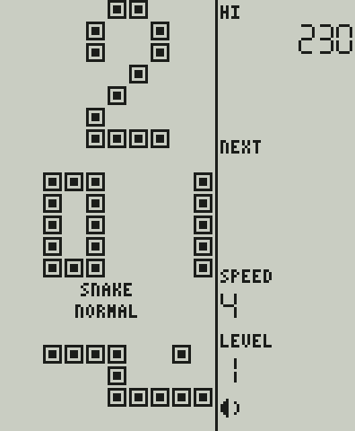
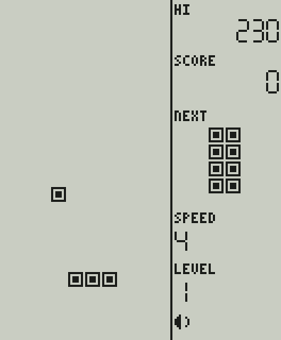
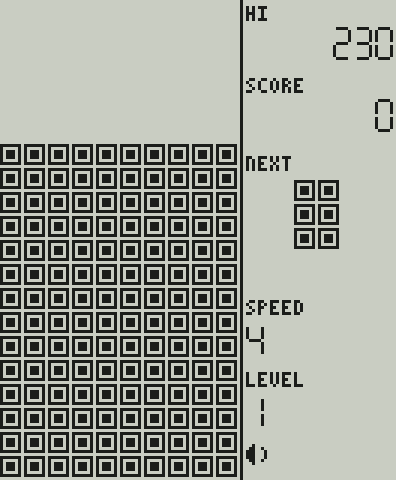

# Snake: что портировано из ApolloBrickGames

**Источник:** [grayhex/ApolloBrickGames](https://github.com/grayhex/ApolloBrickGames), коммит `abd7c3426f28222b54db2fe280597d7578e7191c`, файлы `src/brick/games/library/arcade.ts` (класс `SnakeGame`), `library/common.ts` (`LibraryGame`: потеря жизни, победа, разбор клавиш), `src/brick/e88.ts` (периоды шага), `src/brick/base.ts`, `src/core/rng.ts`.
**Реализация:** `firmware/games/snake/`, C11, поверх общей основы игры (жизни и сцены очистки поля, [FIRMWARE_ARCHITECTURE.md §4](FIRMWARE_ARCHITECTURE.md)). **Один вариант** (ADR-036). **Статус:** прототип. Основной профиль эталон **заявляет** сверенным с исполнением ROM ([rom-arcade.md](https://github.com/grayhex/ApolloBrickGames/blob/abd7c3426f28222b54db2fe280597d7578e7191c/docs/brick/rom-arcade.md): E88 «8 in 1» №5 и E-23 Plus Mark II «96 in 1» №93); **мы ROM не исполняли и это не перепроверяли**. Совпадение нашего порта с эталоном побитовое на каждом такте ([CONFORMANCE.md](CONFORMANCE.md)), с настоящим устройством — не проверялось.

## 1. Объём порта

| | |
| --- | --- |
| Портировано | Вариант **01** (основной профиль, «NORMAL») |
| Не портировано | Вариант **02** «FRAME» (рамка в одну клетку по периметру): владелец решил, что у каждой игры один вариант (ADR-036); раньше он был в коде и убран. Звуки E88 (каналы 0 / 5 / 11 / 12 / 13 / 14): сейчас общие заглушки по событиям; мелодии |
| Идентификатор | `uid` 2 (в сохранениях не меняется), `id` `snake`, на экране «SNAKE», в меню знак «2» |

## 2. Правила и их достоверность

| Правило | Значение | Основание (по эталону; мы не перепроверяли) |
| --- | --- | --- |
| Старт | голова `(5, 0)`, хвост `(3, 0)` при отсчёте `y` снизу, то есть червяк лежит в нижнем ряду и ползёт вправо | ROM E88 / E-23 |
| Клавиша направления | голова делает шаг сразу, таймер шага начинается заново; шаг в том же направлении тоже шаг | ROM |
| ACTION (ROTATE) | четвёртое направление: **вверх**; удержание не ускоряет и не повторяет | ROM (в эталоне поправлено: раньше считалось турбо) |
| Противоположное направление | голова и хвост меняются местами, червяк разворачивается целиком (направление берётся по бывшему хвосту), шага при этом нет, таймер сохраняется | ROM |
| Шаг без клавиш | период по скорости 1…10: 332,358 · 299,334 · 266,316 · 233,764 · 200,738 · 168,178 · 135,156 · 102,128 · 70,056 · 37,038 мс; на 60 Гц период дробный (19,94 … 2,22 тактов), остаток переносится | медианы по ROM E88 (E-23 даёт те же значения с точностью 1 мс) |
| Ход в клетку, которую освобождает хвост | разрешён, пока червяк не растёт | реконструкция эталона |
| Еда | +10 очков; новая еда в случайной свободной клетке | ROM (+10); место еды — датчик случайных чисел с зерном вместо свободного таймера прошивки, **допущение** |
| Победа | 13 плодов за уровень: +100 очков, сцена очистки, следующий уровень | **адаптация эталона**: 13 плодов и +100 не подтверждены ROM |
| Жизни | четыре; потеря: стена (край поля), собственное тело; сцена очистки 60 тактов, затем новый раунд; без жизней — заливка поля и конец игры | число жизней согласуется с индикатором E88; сцены — допущение (как у всех игр библиотеки) |
| Мигающие клетки | голова и еда | эталон |

Следствия для выбора панели ([DISPLAY_CANDIDATES.md](DISPLAY_CANDIDATES.md), риск R-9): ход змейки по таблице периодов — 3,0 шага в секунду на скорости 1, 5,0 на скорости 5, 14,3 на скорости 9 и **27 шагов в секунду на скорости 10** (расчёт по таблице, не измерение). При панели, принимающей 10 новых картинок в секунду, на скорости 9 змейка проходит 1,4, а на скорости 10 — 2,7 клетки между двумя показанными картинками: на верхних скоростях ход перестаёт читаться. Это обязательно проверить в гейте G1 ([ROADMAP.md](ROADMAP.md)) 10, 15, 20 и 30 кадрами в секунду.

## 3. Управление в консоли

Меню и пауза такие же, как у Tetris ([UI_MENU.md](UI_MENU.md)). В игре: четыре кнопки направлений и большая ACTION («вверх»). Кнопки MODE / SELECT / START игре не видны. FIRE движка (клавиатурный запасной ввод эталона) физической кнопки не имеет: в сверке он учитывается как «вверх», консоль его не посылает.

## 4. Состояние, память, размер

Структура игры `bks_game_t`: основа + тело червяка (до 200 клеток) + несколько полей, `sizeof` укладывается в `BK_GAME_STATE_MAX` (2048 Б; проверяется тестом). Размер кода Snake и новых помощников основы для Cortex-M4F — **только компиляция**: общий размер ядра вырос с 23 469 до 26 422 байт (с вариантом «FRAME» было 26 778), `.data` и `.bss` по-прежнему 0; из libc по-прежнему только `mem*`, `str*`, `fmod` и функции мягкого double.

## 5. Таймер с дробным остатком

Как у гравитации Tetris (ADR-024), период шага не округляется: `timer += 1; if (timer < period) return; timer -= period` на `double`, в том же порядке операций, что в эталоне; период `мс × 60 / 1000` вычисляется так же. Сборка с `-ffp-contract=off`. Побитовая сверка подтверждает совпадение на хосте (gcc, clang, ASan/UBSan) и в WebAssembly (сеансы симулятора); **на Cortex-M4F вычисление не запускалось** (R-1).

## 6. Миниатюра меню

Рисунок миниатюры (червяк ползёт к плоду, два кадра) нарисован для этого проекта, это не спрайт эталона: к нему не применяется оговорка R-3 о правах на спрайты.

## 7. Тесты

* `tests/conformance/test_snake_conformance.c` — **66 сценариев, 74 576 тактов**, дайджест полного состояния на каждом такте; мутационные прогоны: 17 из 17 внесённых ошибок пойманы ([CONFORMANCE.md §5](CONFORMANCE.md)).
* `tests/unit/test_snake_rules.c` — читаемые случаи: старт, дробный период (первый шаг на 20-м такте), мгновенный шаг по клавише, разворот прямого и изогнутого червяка, ROTATE как «вверх» без турбо, еда и свободная клетка для новой еды на 200 зёрнах, потеря жизни стеной и телом, «хвост освобождает клетку», конец игры, победа, индикатор жизней, определение игры (один вариант).
* `tests/unit/test_game_base.c` — новые помощники основы: ограничение жизней, потеря жизни со сценой очистки (формула заливки и стирания по тактам), последняя жизнь, победа, переполнение уровня и скорости.
* `tests/unit/test_screens.c` — золотые кадры: меню Snake, игра, сцена очистки   
* Сеансы симулятора `snake_ref8` и `snake_lcd316_15hz` ([SIMULATOR.md](SIMULATOR.md)): одинаковый результат на хосте и в WebAssembly.
