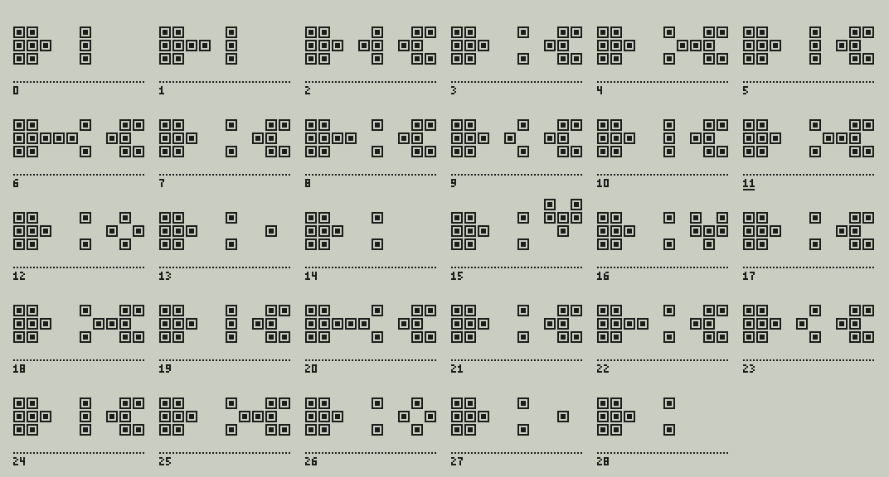
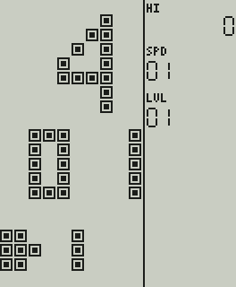
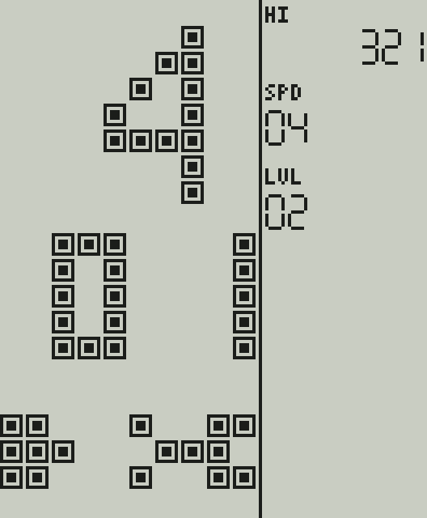
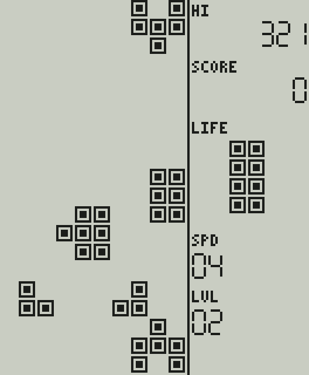
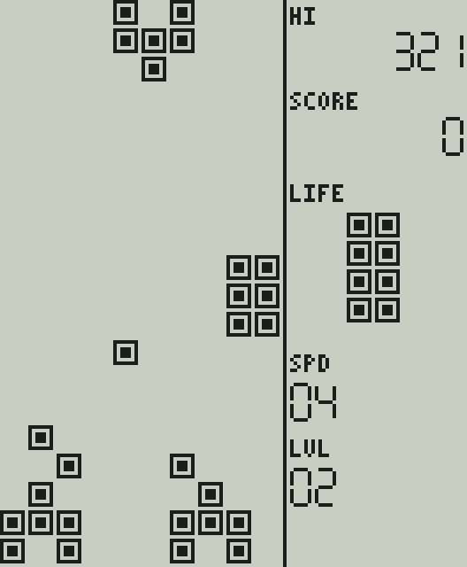

# Tank: что портировано из ApolloBrickGames

**Источник:** [grayhex/ApolloBrickGames](https://github.com/grayhex/ApolloBrickGames), коммит `abd7c3426f28222b54db2fe280597d7578e7191c`, файлы `src/brick/games/tanks.ts`, `tanks/geometry.ts`, `tanks/ai.ts`, `tanks/levels.ts`, `src/brick/base.ts` (жизни, добавочные жизни, взрыв, очистка), `src/brick/timing.ts`, `src/brick/rng.ts`, `src/core/rng.ts`; описание — `docs/brick/tanks.md` эталона. Правила эталон взял у `TanksGame` проекта n0Live/BrickGame (MIT, [THIRD_PARTY.md](../THIRD_PARTY.md)).
**Реализация:** `firmware/games/tank/`, C11, поверх общей основы игры ([FIRMWARE_ARCHITECTURE.md §4](FIRMWARE_ARCHITECTURE.md)). **Один вариант** (ADR-036), решение о составе — ADR-044.

> **Достоверность: реконструкция по донору, НЕ ROM.** Эталон прямо пишет, что подтверждено только наблюдение владельца («игра 1 в „168 в 1 танк“ — танки, 5 вариантов»), а правил, числа врагов, полей и темпа именно этих вариантов Apollo у него нет: игра — перенос `TanksGame` донора. Побитовое совпадение нашего порта с эталоном доказано на каждом такте ([CONFORMANCE.md](CONFORMANCE.md)); с настоящим устройством не сверялось и сверяться не с чем.

## 1. Объём порта

| | |
| --- | --- |
| Портировано | Первый вариант донора (тип 1): **три вражеских танка**, готовые поля препятствий с уровня 2 |
| Не портировано | Остальные семь донорских вариантов: четыре, пять и шесть врагов, случайные поля препятствий. Эталон из них выбрал пять; по решению владельца в первую версию идёт один (ADR-036), поэтому случайная расстановка препятствий (`randomObstacles`, десять попыток, кольцо вокруг фигуры) в C не переносилась вовсе |
| Идентификатор | `uid` 4 (в сохранениях не меняется), `id` `tank`, название «TANK» (в данных игры), в меню знак «4» и клип из 29 кадров (ADR-041) |

## 2. Правила и их основание

Всё ниже — правила донора в изложении эталона; проверено нами только совпадение с эталоном. Координаты донора идут снизу вверх (`y` от нижней строки), на экран они переводятся только при рисовании.

| Правило | Значение |
| --- | --- |
| Танки | танк игрока — 7 клеток, вражеский — 6 (нет клетки позади центра); ствол стоит на клетке перед центром, повороты по правилам донора; «коробка» 3 × 3 нужна только для проверки места появления |
| Поле | 10 × 20; на уровне 1 пусто; на уровнях 2…10 готовые поля препятствий (квадрат, уголок, прямоугольник 3 × 2 в четырёх поворотах): 12, 12, 12, 6, 18, 21, 15, 27, 24 клетки; ни одно поле не задевает место старта игрока (проверяется тестом) |
| Старт | центр танка игрока `(4, 7)`, ствол вверх; перед каждым раундом «стартовая мелодия» 90 тактов: игрок может ездить, враги и выстрелы ждут |
| Ход игрока | первая не приостановленная стрелка по порядку «влево, вправо, вверх, вниз»; смотрит туда же — шаг, иначе поворот на месте (если повёрнутый рисунок во что-то упирается — поворот со ступенькой на клетку вперёд); пауза кнопки 5 тактов (и после шага, и после поворота); новое нажатие проходит сразу, удержание повторяется через 5 тактов |
| Выстрел | ACTION (в эталоне ROTATE, FIRE считается им же); не чаще раза в 14 тактов, не больше 4 своих снарядов в воздухе; нет свободной ячейки — нет выстрела; выстрел не зависит от движения |
| Снаряд | одна клетка; появляется на клетке ствола и сразу делает первый шаг; все снаряды перелетают на клетку раз в 7 тактов (120 мс); за проход сначала шагают снаряды врагов, затем игрока; после попадания в игрока остальные в этот раз стоят |
| Исход шага снаряда | вылет за поле — пропал; встреча с вражеским снарядом убирает оба (снаряд врага убирает и встреченный снаряд игрока); вражеский снаряд в клетку танка игрока — игрока подбили; снаряд игрока во вражеский танк — враг уничтожен; вражеский снаряд во вражеский танк просто пропадает; иначе стирается клетка препятствия; снаряд игрока в снаряд игрока — пропадает налетевший. Попадание считается по клеткам рисунка танка, а не по квадрату 3 × 3 |
| Враги | не больше трёх одновременно; один ход врагов раз в `genuineTicks(скорость, 1500 мс, 350 мс)` = 90, 82, 75, 67, 59, 52, 44, 36, 29, 21 такт на скоростях 1…10; за ход действует **один** танк — первый по кругу, у которого ход получился (номер хода между уровнями не сбрасывается, с новой партией — с нуля) |
| Появление | пока убитые + стоящие на поле < 25 — с вероятностью 3/4; шесть мест (нижние углы, середины боковых краёв, верхние углы), центр сдвигается внутрь поля; нужен свободный квадрат 3 × 3; из трёх попыток удачная третья не засчитывается — на деле две; танк сразу смотрит в сторону игрока; новичок стреляет сразу с шансом 1 к `21 − уровень` |
| Решения ИИ | выбор движения: вес каждого направления (база 0,25; свободный шаг +0,25; закрытый −0,5 и ещё −0,25, если закрыт шаг на длину танка; текущее направление +0,25; к игроку по короткой оси +0,5, по другой +0,25; поперёк курса игрока −0,25), «шейкерная» сортировка, «кубик» на каждое направление с шансом `clamp(вес, 0, 0,95)`; выстрел: шанс `max(1 − (меньшая + большая − 1) / 13, 0)` с поправками (игрок смотрит навстречу +1/13, свой танк на линии −2/13, в упор +10/13, препятствие в пределах 5 клеток +`(9 − расстояние)`/13), итог от 1/13 до 12/13. Все веса и шансы — `double` в том же порядке операций, что в эталоне |
| Очки | +1 за уничтоженный танк, больше ничего; добавочная жизнь за каждые 500 очков, при полных жизнях вместо неё +50 очков |
| Победа в уровне | 25 уничтоженных; очистка поля 314 тактов, уровень +1, счётчик убитых с нуля; после десятого уровня снова первый и скорость +1 (после десятой скорости — первая); начальные скорость и уровень (1…10) приходят из меню, при стартовом уровне выше первого препятствия есть с самого начала |
| Потеря жизни | вражеский снаряд в игрока: взрыв 112 тактов, минус жизнь, очистка 72 такта, **тот же уровень заново** — счётчик убитых и счёт сохраняются; жизней четыре; без жизней — заливка поля и конец игры. Если игрока подбили и набрались 25 убитых в одном такте, сначала обрабатывается попадание |
| Звук | события: выстрел игрока (вражеские выстрелы беззвучны, как у донора), попадание снаряда, уничтожение врага, авария, потеря жизни, добавочная жизнь, победа, рост уровня, конец игры; у всех есть временные сигналы в `audio.c` (ADR-045, R-5): выстрел — короткий «зап» (50 мс, короче интервала огня 233 мс), попадание, падающий сигнал взрыва врага, длинный падающий при аварии, нисходящий при потере жизни, восходящий при добавочной жизни, фанфара победы |

Порядок внутри такта задан явно (у донора снаряды летят в отдельном потоке): паузы кнопок −1, ввод игрока, шаг снарядов (если сработал общий таймер), гибель игрока, победа в уровне, ход врагов и снова проверка гибели.

Следствия для выбора панели ([DISPLAY_CANDIDATES.md](DISPLAY_CANDIDATES.md), риск R-20): по таблице периодов (расчёт, не измерение)

| Что | Скорость | За картинку при 10 Гц | За картинку при 15 Гц |
| --- | --- | ---: | ---: |
| Снаряд, 1 клетка / 7 тактов = 8,6 клетки/с | любая | 0,86 клетки | 0,57 клетки |
| Танк игрока при удержании, 1 шаг / 5 тактов = 12 клеток/с | любая | 1,2 клетки | 0,8 клетки |
| Ход врагов, 90 тактов (0,67 хода/с) | 1 | 0,07 хода | 0,04 хода |
| Ход врагов, 21 такт (2,9 хода/с) | 10 | 0,29 хода | 0,19 хода |

Скорости движения умеренные (рамка Racing на верхних скоростях проходит до 6 клеток за картинку), но у картинки при 10 Гц нет шанса показать то, что живёт меньше шести тактов: выстрел в упор исчезает в тот же такт, враг при попадании пропадает без вспышки (как у донора). Консоль показывает последний кадр, события звучат в любом случае. Посмотреть глазами на панели при 10, 15, 20 и 30 кадрах в секунду (гейт G1).

## 3. Управление в консоли

Меню и пауза такие же, как у Tetris ([UI_MENU.md](UI_MENU.md)). В игре: ВЛЕВО / ВПРАВО / ВВЕРХ / ВНИЗ — повернуть танк в эту сторону или сделать шаг, большая ACTION — выстрел (зажатая — автоогонь раз в 14 тактов). Кнопки MODE / SELECT / START игре не видны. FIRE (запасной ввод эталона) физической кнопки не имеет.

## 4. Состояние, память, размер

Структура игры `bkk_game_t` (префикс `bkk_`: буква «k» от tanK, потому что `t` занят Tetris): основа + танк игрока, три вражеских танка, снаряды (4 + 3), поле препятствий (200 клеток) и снимок поля для взрыва (200 клеток), `sizeof` = 736 Б, укладывается в `BK_GAME_STATE_MAX` (2048 Б; проверяется тестом). Размер кода для Cortex-M4F — **только компиляция**: `tank.c` 5 388 Б, `tank_ai.c` 2 844 Б, `tank_geometry.c` 8 778 Б, вместе 17 010 Б; общий размер ядра с четырьмя играми 52 664 Б (с тремя было 35 654; сигналы игровых событий ADR-045 добавили ещё 184 Б); `.data` и `.bss` по-прежнему 0. Таблицы фигур и полей лежат в коде как постоянные данные.

Решения ИИ считаются на `double` в том же порядке операций, что в эталоне (`-ffp-contract=off`): сумма весов и шансов, бросок `u32 / 2^32` против шанса. Новых функций библиотеки компилятора Tank не требует (те же 11 мягких `__aeabi_*`, что уже нужны остальному ядру); ИИ работает один раз за ход врагов (не чаще 2,9 раза в секунду), поэтому нагрузка мала, но на Cortex-M4F она не измерена и на плате не запускалась (R-1, R-8). Побитовое совпадение с эталоном на Cortex-M4F проверять прогоном на целевом процессоре.

## 5. Миниатюра меню

Клип из 29 кадров (петля 4,8 с, 6 картинок в секунду, постер — кадр 11) нарисован для этого проекта, это не спрайт эталона: к нему не применяется оговорка R-3 о правах на спрайты. Нижние пять рядов поля сбоку: танк игрока слева стреляет в стену из трёх клеток и во вражеский танк справа; снаряды встречаются и гаснут, выстрел через пролом уничтожает врага, второй враг въезжает сверху, поворачивается к игроку и повторяет судьбу первого; стена восстанавливается в точке склейки.  

## 6. Тесты

* `tests/conformance/test_tank_conformance.c` — **107 сценариев, 158 841 такт**, дайджест полного состояния на каждом такте ([CONFORMANCE.md §3.4](CONFORMANCE.md)); секции `rng`, `enemyTicks` (десять периодов хода врагов, точное равенство), `masks` (12 рисунков), `levels` (десять готовых полей), `aiSamples` (398 примеров: веса направлений и шанс выстрела как IEEE `double` побитово), `moveSamples` (300 ходов танка), `pickSamples` (40 выборов направления с тем же числом брошенных кубиков); мутационные прогоны ([CONFORMANCE.md §5](CONFORMANCE.md)).
* `tests/unit/test_tank_rules.c` — читаемые случаи: рисунки и маски танков, края поля, готовые поля, темп врагов, вступление (ездить можно, стрелять нельзя), шаг и поворот, огонь и четыре снаряда, исходы шага снаряда, появление врагов в шести местах и занятое место, вероятность появления, решения ИИ (направление выстрела, сортировка весов, закрытый интервал «кубика», шанс выстрела), потеря жизни и новый раунд того же уровня, 25 убитых, добавочные жизни, новая партия начинает круг врагов заново, определение игры.
* `tests/unit/test_screens.c` — золотые кадры: меню, игра, взрыв   
* `tests/unit/test_clips.c` — клип хорошо сформирован (петля без скачка, не больше 10 картинок в секунду, не пустой и не залитый кадр).
* Сеанс симулятора `tank_lcd316_15hz` ([SIMULATOR.md](SIMULATOR.md)): одинаковый результат на хосте и в WebAssembly.

## 7. Отличия от донора и допущения

* **Время в тактах (60 Гц):** шаг 90 мс = 5 тактов; донорский поворот 360 мс = 22 такта сокращён проектом до 5 (доработка отзывчивости эталона: новое нажатие проходит сразу, движение не задерживает выстрел); огонь 240 мс = 14; снаряд 120 мс = 7; стартовая пауза 1500 мс = 90; очистка поля 1200 / 5240 мс = 72 / 314.
* **Потоков нет:** порядок в такте задан явно (см. выше). **Случайность** — `Rng` основы, а не `java.util.Random`: последовательности другие, распределения (шансы, веса, порядок бросков) те же.
* **Не воспроизведено:** задержка 60 мс между появлением новичка и его первым выстрелом; «снять кнопку огня из набора нажатых» после шага; сохранение партии и паузы окна (в ядре — события и оболочка).
* **Описание эталона противоречиво:** раздел «Допущения» его `tanks.md` пишет, что ввод во время стартовой паузы не принимается, а раздел «Отличия» и код эталона разрешают ездить. Порт следует коду (сценарий `intro-driving-allowed` сверен на каждом такте).
* **Препятствия под стартовым танком:** у донора случайные препятствия могут лечь под танк и слиться с ним; у готовых полей этого нет, а случайных мы не переносили, поэтому соответствующего кода в C нет.
* **Счёт** ограничен основой (`MAX_SCORE`); на 1 очко за врага это недостижимо.
* **Не установлено:** что в вариантах настоящего устройства на самом деле — число врагов, поля, уровни, ограничение на число убитых, темп. Значения здесь — донорские.
