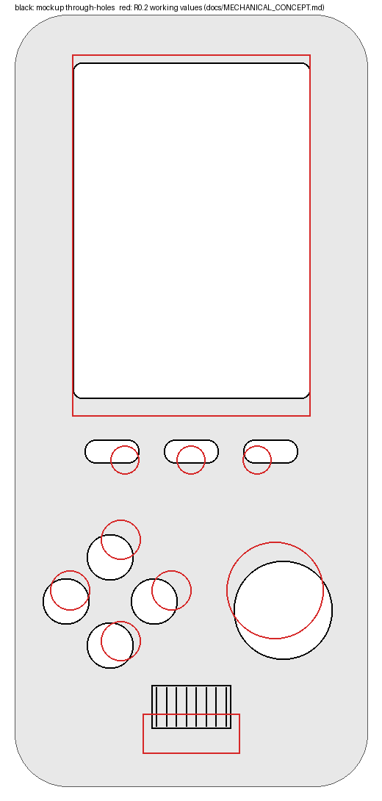
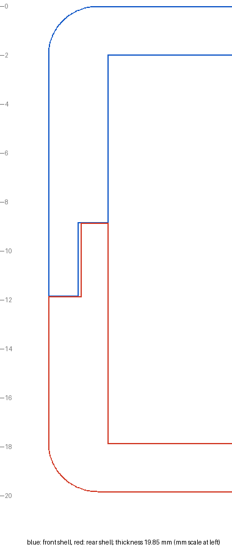

# Разбор первого CAD-макета корпуса (buildcad.ai)

**Дата:** 2026-10-19. **Статус:** обзор входного материала. Решений по корпусу не принимает; значения R0.2 в [MECHANICAL_CONCEPT.md](MECHANICAL_CONCEPT.md) этим документом **не меняются** — расхождения вынесены владельцу и CAD-исполнителю (ADR-031). Прошивку и PCB этот разбор не затрагивает.

## 1. Что разобрано и чем

- Архив из 13 бинарных STL, присланный владельцем: [mechanical/inbox/buildcad-r0.1/](../mechanical/inbox/buildcad-r0.1/README.md) (SHA-256 и происхождение там же). Ссылка на редактируемую модель buildcad.ai без входа открывает только страницу авторизации, поэтому **анализ идёт только по STL**: нет параметров, имён элементов, материалов, цвета и печатных масок.
- Инструмент: [tools/cad_review/stl_review.py](../tools/cad_review/stl_review.py) (Python, numpy, Pillow). Размеры берутся из треугольников; растровые измерения отверстий точны до ≈ 0,1 мм (проверено по точным вершинам: окно 54,0 × 76,0, отверстие кнопки Ø10,30, Action Ø22,30). Сечения и «сумма слоёв» — по плоскостям треугольников. Результат сохранён в `measurements.json`, CI проверяет, что он воспроизводится.
- Система координат — R0.2: начало в левом верхнем наружном углу лица, X вправо, Y вниз, мм. Детали лежат на «плите», поэтому инструмент поворачивает переднюю оболочку в эту систему при допущении «верх устройства — торец с окном» (допущение проверяется: окно оказывается в верхней половине).

## 2. Главный вывод

Макет **в целом совпадает с утверждённой раскладкой R0.2**: вытянутый прямой корпус 175 × 80 мм; окно экрана сверху; **три кнопки MODE / SELECT / START сразу под окном**; четыре **раздельные** кнопки направлений с отдельными круглыми отверстиями; одна большая круглая Action; **одна** решётка динамика спереди внизу по центру; на нижнем торце **единственное** отверстие под USB-C по центру; на задней стенке и боках отверстий динамика нет. Собранная толщина — **19,85 мм** (полунахлёст по линии разъёма), то есть попадает в цель ≈ 20 мм, а не в 30,75 мм, как получается при простой сумме глубин двух оболочек.

Но по цифрам видно **14 расхождений и вопросов** (раздел 4): часть — отклонения от рабочих значений R0.2 (шаг и размер кнопок направлений, высота окна, положение динамика), часть — недоделки макета (нет посадочных мест под выключатель и колесо громкости, колпачки кнопок получаются утопленными, USB-проём уже штекера). Для печатного макета эргономики это хорошая отправная точка; как исходник для литья или DFM он не годится (только STL: нет параметров и допусков, у четырёх колпачков направлений по 2 открытых ребра).

## 3. Что в макете (измерено)

| Деталь | Размер, мм | Примечание |
| --- | --- | --- |
| `front` | 175 × 80 × 17,95 | полая лицевая оболочка; стенка 2,4, лицевая пластина 2,0; радиус угла в плане ≈ 12,1 (концепт R0.2: 8–11), скругление кромки лица ≈ 2 |
| `rear` | 175 × 80 × 12,80 | полая задняя оболочка; стенка 2,4, плита 2,0 |
| `lens` | 81,7 × 59,7 × 0,9 | плоская пластина без печатной маски в геометрии |
| `action` | Ø24,0 × 3,65 | фланец Ø24,0 (2,45) + «ножка» Ø22,0 (1,2) |
| `dir_up/left/right/down` | 12,0 × 12,0 × 3,65 | фланец Ø12,0 (2,45) + «ножка» Ø10,0 (1,2); стрелка-глиф на верху; по 2 открытых ребра у каждой детали |
| `btn_mode/select/start` | 15,0 × 8,0 × 3,65 | фланец 15 × 8 (2,85) + «ножка» 12 × 5 (0,8) |
| `wheel` | Ø16,0 × 3,0 | рифлёный диск |
| `power` | 8,0 × 6,1 × 3,0 | прямоугольная деталь, 28 треугольников |

Остальные детали — замкнутые сетки (открытых рёбер нет).

### Стыковка оболочек и толщина

Разъём — **полунахлёст**: у лицевой оболочки на краю стенки наружный выступ шириной 1,2 мм (кромка на глубине 11,85), у задней — внутренний шириной 1,05 мм (кромка на глубине 11,0). Упоры: кромка лицевой (11,85) + уступ задней (8,0) = **19,85 мм**; кромка задней (11,0) + уступ лицевой (8,85) = **19,85 мм**. Боковой зазор между выступами 0,15 мм (стартовое допущение CAD-задания для печати — 0,2–0,4 мм). Внутренний свободный объём по толщине между внутренними поверхностями пластин: 19,85 − 2 × 2,0 = **15,85 мм** (до учёта выступов и бобышек); хватит ли его на дисплей с подсветкой, плату и аккумулятор — отдельное исследование, цифры стека в проекте не подтверждены.

## 4. Сравнение с R0.2 и найденные вопросы

Рабочие значения R0.2 — **предложения**, не утверждённые допуски ([MECHANICAL_CONCEPT.md §2](MECHANICAL_CONCEPT.md)); макет мог быть сделан осознанно иначе. Решает владелец.

| Элемент | Макет | R0.2 | Δ |
| --- | --- | --- | --- |
| Окно LCD (x, y, ширина, высота) | 13,1; 11,0; 54,0; 76,0 | 13; 9; 54; 82 | высота −6, верх на +2 |
| Направления: центры ↑ ← → ↓ | (21,6; 123,0), (11,6; 133,0), (31,6; 133,0), (21,6; 143,0) | (24; 119), (12,5; 130,5), (35,5; 130,5), (24; 142) | крест смещён и сжат |
| Шаг противоположных кнопок | 20,0 | 23,0 | −3,0 |
| Отверстие кнопки направления | Ø10,3 (ножка Ø10,0, фланец Ø12,0) | Ø8,5–9 | +1,3…1,8 |
| Зазор между соседними по диагонали | 3,8 по отверстиям, 2,1 по фланцам | ≥ 5 | −1,2 / −2,9 |
| Action: центр / отверстие | (60,8; 135,0) / Ø22,3 | (59; 130,5) / Ø21–22 | +1,8; +4,5 |
| Функции MODE / SELECT / START | прорези 12,3 × 5,3, центры (22; 99), (40; 99), (58; 99), шаг 18 | круглые Ø6,5, (25; 101), (40; 101), (55; 101), шаг 15 | форма, шаг +3, выше на 2 |
| Решётка динамика | 8 щелей шириной ≈ 1,4, шаг 2,4, габарит 18 × 10, центр (40; 157), открытая площадь ≈ 107 мм² | ≈ 22 × 9, центр (40; 163) | выше на 6, уже на 4 |
| Толщина в сборе | 19,85 | 20 (22 запас) | −0,15 |
| Радиус угла в плане | ≈ 12,1 | 8–11 | +1,1 |

Нумерация вопросов — для обсуждения и задач CAD. «Серьёзность»: **В** — мешает использовать макет как есть; **С** — решить до печати/заморозки; **Н** — заметка.

| № | Серьёзность | Наблюдение (измерено) | Что нужно |
| --- | --- | --- | --- |
| M-1 | Н | Полунахлёст даёт 19,85 мм, а не 30,75 мм (сумма глубин 17,95 + 12,80 вводит в заблуждение: бобышки и лицевая стенка заходят друг в друга). Зазор по оси при расчётной толщине 20 мм — 0,15 мм, боковой зазор нахлёста 0,15 мм | Сохранить подход; подтвердить зазоры на печатном образце |
| M-2 | С | Окно 54,0 × 76,0 повторяет **габарит стекла** Sharp (47,02 × 76,00), а не видимую область (42,672 × 68,072). Видимая рамка вне активной области: 5,6 мм по бокам и 4,0 мм сверху/снизу; стекло длиннее окна на 0,0 мм, то есть край стекла совпадает с краем окна. Углубление под линзу 60 × 82 × 1,0 (линза 81,7 × 59,7 × 0,9, зазор 0,15) | Определить видимую апертуру по активной области + допуск (печатная чёрная маска на линзе или рамка), а не по габариту стекла. Пока панель не выбрана — держать окно сменным (MECHANICAL_CONCEPT §3) |
| M-3 | С | Кнопки направлений: шаг 20 мм (R0.2 — 23), отверстие Ø10,3, фланцы Ø12,0 при расстоянии по диагонали 14,1 мм → зазор 3,8 мм между отверстиями и **2,1 мм между фланцами**; целевой интервал R0.2 между краями соседних кнопок ≥ 5 мм. Риск ложных диагональных нажатий (R0.2: «минимизировать») | Решить: увеличить шаг до 23 мм (по R0.2) или сузить фланцы/ножки; проверить 1:1 на печатном макете |
| M-4 | С | Высота «ножки» колпачка меньше толщины пластины: направления/Action 1,2 мм, функции 0,8 мм при пластине 2,0 мм. Если фланец прижат к внутренней поверхности пластины (предположение о положении), верх колпачка **утоплен на 0,8 мм (направления, Action) и на 1,2 мм (функции)** ниже лицевой поверхности. Зазор ножки в отверстии 0,15 мм на сторону | Уточнить замысел: выступание кнопок над лицом и ход; изменить длину ножек или местами утончить пластину |
| M-5 | С | Функциональные кнопки — **прорези 12,3 × 5,3**, не круглые Ø6,5 (R0.2/CAD-задание: «маленькие круглые»). Шаг 18 мм, центры на y = 99 (R0.2 — 101); от окна до верхнего края прорези ≈ 9,4 мм. Надписи MODE / SELECT / START выгравированы на лице под прорезями (≈ y 108, глубина ≈ 0,3 мм; по рендеру и граням, отдельно не измерялось) | Владелец: круглые или прорези. Подписи должны остаться читаемыми на утверждённой форме |
| M-6 | С | Решётка динамика: 8 вертикальных щелей 1,4 × 10 мм, центр (40; 157), верхний край y = 152,0 — всего **3,9 мм** от нижнего края отверстия кнопки «вниз» (y = 148,1). R0.2: ≈ 22 × 9 в зоне y 158–168. Открытая площадь ≈ 107 мм²; акустика (камера, диаметр динамика) в модели не задана | Сдвинуть вниз или согласовать; площадь отверстий — по выбранному динамику и камере |
| M-7 | С | **Нет посадочных мест под выключатель питания и колесо громкости**: в боковых стенках обеих оболочек нет вырезов. Детали `power` (8,0 × 6,1 × 3,0) и `wheel` (Ø16 × 3) лежат отдельно. В кромке лицевой оболочки есть выемки: левая 11 мм (y 34,5–45,5, глубина 1,03), правая 15 мм (y 52,5–67,5, глубина 1,53); назначение не указано, места не совпадают с R0.2 (колесо слева y ≈ 118–133, выключатель справа y ≈ 98–108); при размерах выемок слева подошёл бы `power`, справа — не подходит Ø16 | Выбрать крепление (утопленный выключатель и колесо — CAD-задание), нарисовать вырезы и сидения |
| M-8 | В | **USB-C проём ступенчатый:** снаружи (первый 1,0 мм стенки) 9,0 × 5,6, внутри (остальные 1,4 мм) — **7,2 × 3,55**; по центру x = 40,0 (положение утверждено). Ось проёма лежит на ≈ 3,8 мм от лица, то есть плата должна идти прямо под лицевой пластиной — стек не проверен. По спецификации USB Type-C металлическая часть штекера 8,25 × 2,4 мм (значение из памяти, **сверить** со спецификацией и даташитом выбранного разъёма) — внутренняя ступень уже; корпус кабеля шире ещё | Спроектировать проём по реальному разъёму и «усу» кабеля; проём не должен быть уже нужного ни на какой ступени |
| M-9 | С | Винты: четыре бобышки на лицевой оболочке (центры (5,1; 18), (74,9; 18), (5,1; 157), (74,9; 157), Ø5,0), в задней — четыре сквозных отверстия под них с зенковкой (Ø≈4,2 → Ø2,4), положения совпадают. Конец бобышки на 17,95 мм, внутренняя поверхность задней плиты — на 17,85 мм: **перекрытие 0,10 мм** (прижим или помеха — нужно решить). Бобышки Ø5 сидят в 5,1 мм от наружной стенки толщиной 2,4 мм и сливаются с ней | Решить прижим/зазор бобышки; проверить, что размера резьбового места хватает (не оценивалось) |
| M-10 | Н | В задней оболочке четыре стойки Ø5,0 высотой 12,8 (до 7,05 мм от лица) в точках плиты X = 30/165, Y' = 14/66; назначение не указано (опоры платы?), модели платы нет — оценить нельзя | Привязать к контуру платы, когда он появится |
| M-11 | Н | Стенка 2,4, плита 2,0 мм — толще стартовых ориентиров CAD-задания (1,6–2,0 мм); радиус угла в плане 12,1 против 8–11 | Принять или поправить; на DFM не влияет |
| M-12 | Н | Макета нет: дисплея, подсветки, платы, аккумулятора, динамика с камерой, USB-C, антенной зоны, винтов — только корпус, колпачки, линза | См. состав в CAD_HANDOFF_PROMPT |
| M-13 | Н | Только STL: нет параметров и STEP, у `dir_*` по 2 открытых ребра (вероятно, глиф стрелки) | Исходник — параметрическая модель (FreeCAD/CadQuery) по CAD-заданию, а не этот STL |
| M-14 | Н | Допущение об ориентации (верх = торец с окном) выведено из положения окна; порядок кнопок MODE→SELECT→START слева направо подтверждается подписями на рендере, остальное — из геометрии | — |

## 5. Что подтверждено относительно CONFIRMED-требований

| Требование | Статус в макете |
| --- | --- |
| Четыре раздельные круглые кнопки направлений (ADR-020) | да, четыре отдельных детали и отверстия; шаг и размер — M-3 |
| Одна большая гладкая Action | да, Ø22,3 в плите; верх гладкий |
| Три кнопки MODE / SELECT / START сразу под LCD | да, под окном; форма — M-5 |
| Один динамик, спереди внизу по центру, без других отверстий (ADR-021) | решётка спереди внизу по центру; отверстий на торцах, боках и задней стенке, кроме USB-C, нет (проверено по покрытию стенок) |
| USB-C на нижнем торце по центру — единственный (ADR-006/021) | да, по центру; размер проёма — M-8 |
| Боковые выключатель питания и колесо громкости | **нет вырезов** — M-7 |
| Положительный монохромный LCD, 10 × 20 + колонка справа | в макете только окно; видимая апертура — M-2 |
| Три отделки на одной механике | в STL не выражено (нет материалов) |

## 6. Что дальше

1. Владелец: выбрать значения из пары «макет / R0.2» по пунктам M-2…M-7 (форма и шаг кнопок, высота окна, положение динамика, выключатель и колесо).
2. CAD-исполнитель: параметрическая модель по [CAD_HANDOFF_PROMPT.md](CAD_HANDOFF_PROMPT.md); сверка новых ревизий этим же инструментом (`--verify` против сохранённых измерений) и рисунок «макет поверх R0.2».
3. Эксперименты, которые не делаются по STL: 3D-печать, эргономика кнопок 1:1 (M-3, M-4), акустика (M-6), посадка USB-C и кабеля (M-8), посадка дисплея в окно (M-2).

Не проверено: посадка реальных комплектующих, звук, жёсткость и усадка, допуски, технологичность литья.
