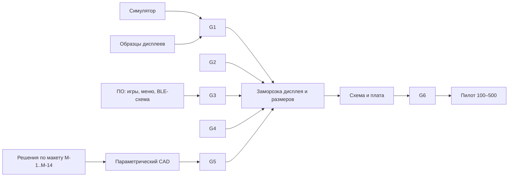

# Дорожная карта проекта Brick

**Статус:** PROPOSED, рабочий документ. **Без дат, цен и сроков:** их нельзя вывести из данных, которые есть сегодня (AGENTS.md: не придумывать сток, цены, время работы батареи, результаты тестов). Вместо сроков здесь гейты: что должно быть измерено или решено, чтобы перейти дальше. Все числа в документе взяты из других документов репозитория; новых оценок здесь нет.

## 1. Где мы сейчас

| Область | Сделано | Не сделано / OPEN |
| --- | --- | --- |
| Требования | PRD 0.6: подтверждённый набор кнопок, экран 10 × 20 + колонка справа, положительная полярность, BLE только для телефона, звук только встроенный | Состав десяти игр (PRD §8), функции приложения для телефона, microSD, цена |
| Программное обеспечение | Ядро на C11, общая основа игр (жизни, сцены очистки), Tetris (один вариант) и Snake (один вариант) с побитовой сверкой по каждому такту, меню на два игры, настройки, рекорды, подгонка под панель, ограничитель частоты показа, ПК-симулятор (терминал и браузер) | Racing и Tank (остаток первой версии), BLE, USB/DFU, загрузчик, драйверы, запуск на целевом процессоре |
| Дисплей | Три кандидата с расчётом посадки пикселей и читаемости (расчёт по паспорту) | Образцы, оптика, подсветка, **играбельность при 10 Гц и выше** (у фаворита `fSCS` 1…10 Гц), энергопотребление |
| Механика | Концепт R0.2 (рабочие значения), CAD-задание, **первый макет владельца измерен** ([MECHANICAL_MOCKUP_REVIEW.md](MECHANICAL_MOCKUP_REVIEW.md)) | Решения по 14 пунктам обзора, параметрический CAD, печатный макет, эргономика, стек по толщине |
| Электроника | **SoC nRF52840 и NCS v3.4.1 LTS выбраны для V1 ПО (ADR-037)**; есть только инженерные кандидаты остальных узлов | Квалифицировать RF-модуль Raytac, QSPI NOR, LCD, схему, плату, батарею/заряд, USB-C, звук |

## 2. Гейты

Гейты взяты из [HARDWARE_RESEARCH.md §7](HARDWARE_RESEARCH.md) и AGENTS.md. Заморозка платы (PCB) возможна только после гейтов 1–5; до этого PCB не начинается.

| № | Гейт | Что измерить или решить | Критерий приёмки | Что может сделать ПО уже сейчас |
| --- | --- | --- | --- | --- |
| G1 | Дисплей и частота показа | Образцы 2–3 панелей: контраст чёрных пикселей на светлом фоне без подсветки, ночь, равномерность света, время отклика, толщина, поставка | Владелец проверяет играбельность одного и того же сеанса при 10, 15, 20 и 30 кадрах в секунду; порог приёмки задаёт владелец, значения здесь не заданы | Симулятор показывает сеанс при любом пределе и в натуральную величину; записи `.bkt` воспроизводят один сеанс на разных пределах ([SIMULATOR.md](SIMULATOR.md)) |
| G2 | BLE и телефон | Сопряжение, GATT-настройки, синхронизация, энергия | Демонстрация на образце: соединение, запись настроек, чтение статистики; ток в простое измерен | Черновик схемы GATT (сведения об устройстве, батарея, настройки, синхронизация рекордов) отдельным документом и ADR |
| G3 | Назначение кнопок | Достаточно ли направлений и ACTION для всех игр первой волны | Каждая игра запуска проходится без новых кнопок; назначение MODE / SELECT / START утверждено владельцем | Таблица «игра × кнопка» по [GAME_CANDIDATES.md](GAME_CANDIDATES.md); меню и игры уже играются с предложенным назначением (ADR-025) |
| G4 | Питание | Ток в игре, простое, ночью, BLE, выключении по статьям: дисплей, процессор, звук, регуляторы | Измерено на плате по заранее записанному профилю; рассчитан запас до 20–30 ч (цель, не обещание) | Профиль нагрузки: записанные сеансы; харнес стоимости композиции кадра (R-8) для запуска на плате |
| G5 | Механический макет | Печатный корпус R0.2: кнопки, окно, USB-C, динамик, толщина, посадка аккумулятора и платы, антенна | Эргономика одобрена владельцем; нет ложных диагоналей; посадка дисплея в окно; размеры по пунктам M-2…M-8 | Не ПО: решения владельца и параметрическая модель CAD |
| G6 | DFM / DVT / PVT | Просмотр схемы и платы, SWD и тестовые площадки, защита от переполюсовки и ESD, безопасность батареи, регуляторика | Протоколы испытаний; **никаких заявлений о соответствии без записей** | Самотест и режим заводской проверки в прошивке, когда появится плата |

## 3. Треки

* **Системная прошивка (можно начинать сейчас):** [nRF52840 DK + NCS 3.4.1 LTS](MCU_PLATFORM_NRF52840.md), [MCUboot подписанное обновление USB-C + независимое recovery/slot1 QSPI](FIRMWARE_UPDATE_NRF52840.md). Нужны реальные DK sysbuild/flash и отчёты для прошивки, без ожидания LCD/PCB.

* **Трек ПО (без железа).** Продолжается независимо: остальные игры ([GAME_CANDIDATES.md](GAME_CANDIDATES.md)), схема BLE, формат сохранений для нескольких игр (рекорды по паре игра + вариант уже есть). Сделано: жизни и сцены основы, обобщённый экспортёр сверки, Snake. Блокируется только запуском на целевом процессоре (R-1, R-8) и выбором панели (читаемость, R-6).
* **Трек механики.** Решения владельца по пунктам обзора макета → параметрический CAD (FreeCAD или CadQuery, STEP) → печать → эргономика. Прошивку под механику не менять.
* **Трек железа.** Образцы дисплеев и платы разработки для гейтов G1, G2, G4; схема и плата только после заморозки.
* **Трек продукта.** Состав десяти игр, функции приложения для телефона, лицензии на спрайты и правила (R-3), регуляторика, целевая цена.

## 4. Решения владельца, от которых зависит работа

| № | Вопрос | Где описан | Что блокирует |
| --- | --- | --- | --- |
| D-1 | Круглые или вытянутые прорези для MODE / SELECT / START; шаг 15 или 18 мм | обзор макета M-5 | CAD, эргономика |
| D-2 | Шаг и диаметр кнопок направлений (макет 20 мм, R0.2 23 мм) | M-3 | CAD, гейт G5 |
| D-3 | Высота окна и способ определить видимую область (маска на линзе) | M-2 | CAD, выбор панели |
| D-4 | Положение решётки динамика | M-6 | акустика, CAD |
| D-5 | Выключатель и колесо громкости: вид и место | M-7 | CAD |
| D-6 | Выступание кнопок над лицом | M-4 | CAD |
| D-7 | Число цифр счёта на узкой колонке (шесть или семь) | [DISPLAY_CANDIDATES.md](DISPLAY_CANDIDATES.md), R-6 | рендер, читаемость |
| D-8 | Назначение MODE / SELECT / START (предложение ADR-025) | [UI_MENU.md](UI_MENU.md) | меню, игры |
| D-9 | ~~Состав первой версии прошивки~~ **решён (ADR-035, ADR-036): Tetris, Racing, Snake, Tank, каждая в одном варианте**; остаются: остальные игры до цели «около 10» и порядок их портов | [GAME_CANDIDATES.md](GAME_CANDIDATES.md) | трек ПО |
| D-10 | Оформление статус-колонки: в рендере-референсе владельца (триптих, иллюстрация, не требование) экран показывает шестицифровой счёт с нулями, HI-SCORE, LEVEL и индикатор игры в узкой колонке; у прошивки сегодня семь цифр и другие подписи | референс-рендер владельца (в репозитории только миниатюра) | рендер статуса |
| D-11 | Порог играбельности по частоте показа | гейт G1 | выбор панели |
| D-12 | microSD, функции приложения для телефона, целевая цена | PRD §8 | плата, BLE |

## 5. Ближайший бэклог ПО (без железа)

Порядок — предложение; критерии приёмки измеримы и не зависят от железа.

1. ~~**Основа для остальных игр:** жизни, `lose`/`win`, накладка поля, сценки потери и победы в `core/game.c`.~~ **Сделано** (ADR-033): тесты основы; состояние сценки входит в дайджест сверки.
2. ~~**Обобщить экспортёр сверки** (`export_tetris.ts` → экспортёр по игре) и раннер.~~ **Сделано:** `tools/conformance/lib.ts`, `tests/support/conf_runner.[ch]`; Tetris даёт прежнюю фикстуру байт в байт, CI проверяет воспроизводимость обеих.
3. ~~**Snake** с побитовой сверкой по тактам.~~ **Сделано** ([GAME_SNAKE.md](GAME_SNAKE.md)): 66 сценариев, 74 576 тактов, мутации 17 из 17, компиляция под Cortex-M4F, строки меню и миниатюра; каталог из двух игр нагружает листание и рекорды. Новый риск **R-10**: ход Snake на скоростях 9–10 против предела 10 Гц.
4. **Racing**, затем **Tank** — остаток первой версии прошивки (ADR-035): одна игра в одном варианте (ADR-036). Приёмка та же, что у Snake: сверка по всем тактам сценариев, мутационная проверка, компиляция под Cortex-M4F, строка меню и миниатюра, проверка размера состояния; перед работой записать, нужна ли арифметика с плавающей точкой, и пометить правила как реконструкцию. Dice владелец портировать не просил.
5. **Харнес стоимости композиции кадра (R-8):** воспроизводимый замер на записях `.bkt`, запускаемый на хосте и на плате разработки.
6. **Черновик схемы GATT** — готов как PROPOSED ([companion/gatt-draft.md](../companion/gatt-draft.md)); осталось оформить ADR по BLE после выбора MCU и проверки на образце; **модель бюджета энергии** по формуле из HARDWARE_RESEARCH §6 с пустыми полями для измерений (без выдуманных значений) — не сделана.
7. Остальные игры после первой версии — только по решению владельца (D-9). Варианты игр не делаются (ADR-036).

## 6. Что не делается без гейтов

Не выбираются деталь, модуль или поставщик; не начинается PCB; не публикуются цены и сроки поставки; не заявляются батарея, ёмкость, часы, регуляторные и сертификационные результаты. Любое предложение сначала оформляется как ADR с критериями приёмки ([DECISIONS.md](DECISIONS.md)).
