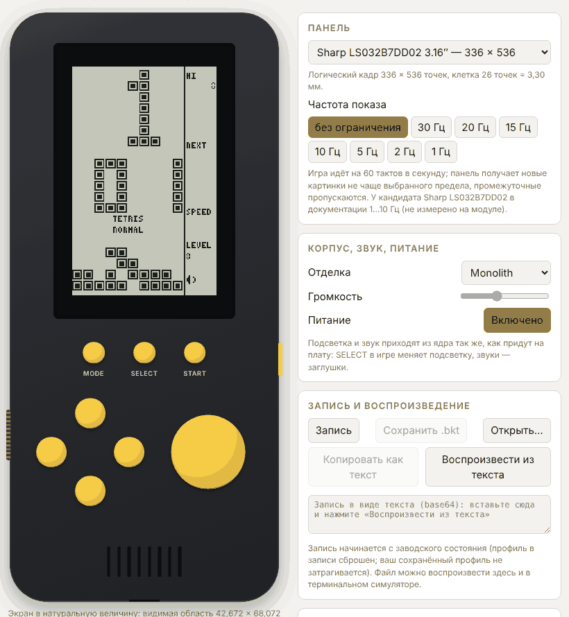
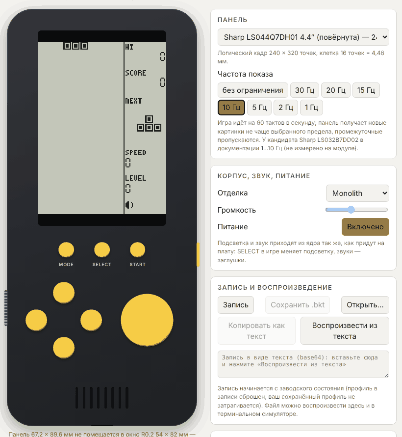

# ПК-симулятор консоли

**Статус:** PROPOSED (ADR-032). Закрывает пункт, отложенный по ADR-029. Это инструмент оценки меню, управления и ощущений от частоты показа на ПК. Он **не эмулирует железо**, не заменяет измерений на настоящей панели и не выбирает ни одной детали.



## 1. Из чего состоит

| Часть | Где | Что делает |
| --- | --- | --- |
| Драйвер `bk_sim` | `platform/sim/sim.[ch]` | Консоль из `firmware/` с «невидимой платой»: кнопки как маска, картинка, которую получила панель, тон динамика, уровень подсветки, профиль в ОЗУ, запись и воспроизведение. Ни окон, ни ОС, ни кучи: тот же файл собирается для ПК и для WebAssembly |
| Каталог игр | `firmware/catalog/catalog.c` | Какие игры входят в изделие, в порядке меню (Tetris, Snake, Racing и Tank). Вынесен из ядра: ядро умеет запускать игру, но не решает, какие игры поставляются |
| Терминал | `platform/sim/term/main.c` | Консоль в окне терминала: Braille-символы 2 × 4 точки, обратная видеопара (тёмные точки на светлом фоне, позитивная полярность), 60 тактов в секунду |
| Браузер | `platform/sim/web/` | Ядро как WebAssembly (63 КБ с четырьмя играми, без libc и импортов) и страница с корпусом по рабочим значениям R0.2: жёлтые раздельные кнопки, экран в натуральную величину, звук, подсветка, запись |
| Мини-libc | `platform/sim/web/libc/` | `memcpy`, `memmove`, `memset`, `memcmp`, `strlen`, `strcpy`, `strncpy` и точный `fmod` (ADR-024) для сборки без libc |

## 2. Как запустить

```sh
# терминал (Linux / macOS)
cmake -S . -B build -G Ninja && cmake --build build
build/platform/brick_sim_term                      # эталонная сетка, клетка 8 точек
build/platform/brick_sim_term --panel 336x536 --fps 10   # подгонка под кандидата, панель показывает ≤ 10 картинок в секунду
build/platform/brick_sim_term --record сеанс.bkt   # записать кнопки сеанса
build/platform/brick_sim_term --replay сеанс.bkt --fast  # без ожидания; печатает хэш последней картинки

# браузер: одна самодостаточная страница
sh platform/sim/web/build_wasm.sh --html           # нужны clang с целью wasm32, lld и python3
# → build-wasm/brick-sim.html (её же публикует CI как артефакт `brick-simulator`)
```

Управление одинаково: **стрелки** — четыре кнопки направлений, **Пробел / Z** — ACTION, **A / S / D (Enter)** — MODE / SELECT / START (назначение — предложение, ADR-025); в браузере те же кнопки нажимаются мышью и пальцем. Терминал не получает отпускания клавиш, поэтому клавиша считается нажатой 10 тактов после последнего события; в браузере состояние клавиш настоящее, а короткое касание держится не меньше 3 тактов.

## 3. Панель и частота показа

Страница показывает видимую область панели **в натуральную величину** внутри окна R0.2 (54 × 82 мм): для кандидата Sharp 3.16″ это 42,672 × 68,072 мм, клетка 26 точек = 3,30 мм, статус-колонка 9,7 мм — читаемость цифр и подписей оценивается глазом на реальных пропорциях (R-6). Панель 4.4″ (67,2 × 89,6 мм) в окно не помещается: страница показывает её уменьшенной и предупреждает об этом; 2.7″ влезает, но колонка статуса остаётся узкой.



Переключатель «Частота показа» задаёт `bk_display_port_t.max_fps` (ADR-030): игра идёт на 60 тактов в секунду, панель получает новые картинки не чаще предела, промежуточные пропускаются, показывается последняя. На странице видно, сколько картинок показано в секунду и сколько ожидавших картинок было заменено. Это **грубый способ ощутить гейт FPS** (R-9) до появления настоящего модуля: симулятор не воспроизводит время отклика пикселей (≈ 30 мс по даташиту) и инерцию LCD.

## 4. Записи сеансов

Файл `.bkt` (BKT1, формат в `platform/sim/sim.h`): конфигурация (панель или сетка, предел частоты, зерно) и одна маска кнопок на такт. Сеанс воспроизводится бит в бит: одно зерно и один ввод дают те же картинки. Запись начинается с заводского состояния (профиль сброшен, чтобы воспроизведение стартовало оттуда же); сохранённый в браузере профиль запись не трогает. Страница умеет сохранить файл, а также передать запись текстом (base64) — это работает и там, где скачивание запрещено.

Применение: один и тот же сеанс можно проиграть на 10, 15, 20 и 30 Гц и сравнить впечатление (R-9); записи годятся как воспроизводимая нагрузка для измерений на плате. Для Snake записаны `snake_ref8` (сетка 8 точек, предел не задан), `snake_lcd316_15hz` и `racing_lcd316_15hz` (панель 336 × 536, 15 Гц); ход змейки на высоких скоростях — самая тяжёлая нагрузка на частоту показа (R-10, [GAME_SNAKE.md](GAME_SNAKE.md)).

## 5. Что проверяется

| Проверка | Что доказывает |
| --- | --- |
| `test_sim` (129 проверок) | HAL-проводка, детерминизм (одно зерно и ввод — одни картинки), запись и воспроизведение, отказ на повреждённых файлах, предел записи, предел частоты можно менять на ходу, профиль переживает перезагрузку, подсветка и тон доходят до оболочки |
| `tests/fixtures/sim/*.bkt` + `expected.txt` | Семь записанных сеансов (Tetris на сетке, Tetris на 336 × 536 при 10 Гц, меню и настройки (все пункты списка, анимация DEMO), Snake на сетке, Snake, Racing и Tank на 336 × 536 при 15 Гц) дают записанные: число тактов, показанных и ожидавших картинок, хэш последней картинки. Файлы создаёт `tools/sim/make_traces.py` по нативной сборке |
| `test_minlibc` | `fmod` из мини-libc совпадает с libm **бит в бит** на миллионах случаев (в т.ч. денормализованные числа и огромные отношения), остальные функции совпадают с libc |
| `test_wasm` (`tests/web/test_wasm.mjs`) | Модуль WebAssembly не требует импортов; те же семь сеансов в WebAssembly дают **те же числа и хэши, что нативная сборка**; API страницы (размеры кадра, профиль, запись) работает |

Вывод по переносимости: ядро с таймером на `double` + `fmod` даёт на WebAssembly (другой компилятор, другой libc, 32-битные указатели) те же картинки, что на ПК. Это **не** сверка с эталоном на каждый такт (её делает `test_tetris_conformance` на ПК) и **не** проверка soft-double на Cortex-M4F (R-1 остаётся открытым).

Пересоздать фикстуры после намеренного изменения вида экранов или правил: `python3 tools/sim/make_traces.py build/platform/brick_sim_term tests/fixtures/sim` и показать diff `expected.txt` на проверку.

## 6. Ограничения и что не сделано

* Корпус на странице — **рабочие значения R0.2** (предложение, не чертёж); первый макет владельца разобран отдельно ([MECHANICAL_MOCKUP_REVIEW.md](MECHANICAL_MOCKUP_REVIEW.md)), страница под него не подгонялась.
* Звук — прямоугольная волна по частотам ядра, не динамик с камерой; громкость и подсветка условны.
* Размер кода и скорость WebAssembly ничего не говорят о Cortex-M4F; стоимость композиции кадра на MCU по-прежнему не измерена (R-8).
* Профиль страницы хранится в `localStorage` — удобство просмотра, не надёжное хранилище; на плате это флеш со слотами A/B (ADR-028).
* Нет окна SDL, геймпадов, второй игры (каталог из одной записи) и эмуляции инерции панели.
