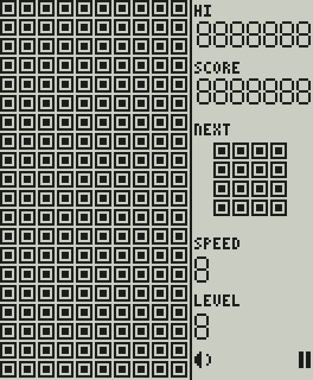
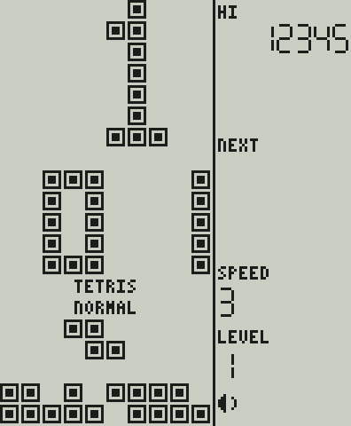
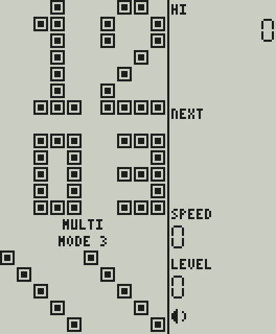
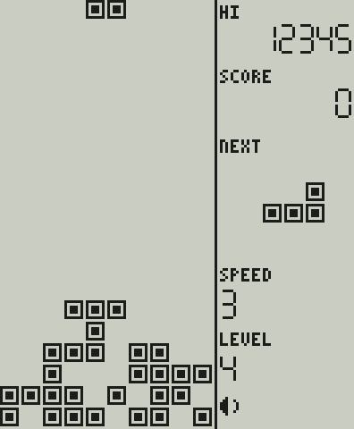
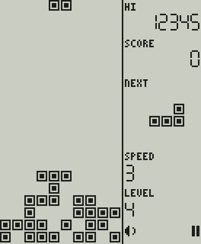
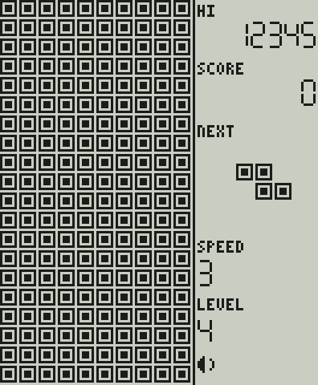
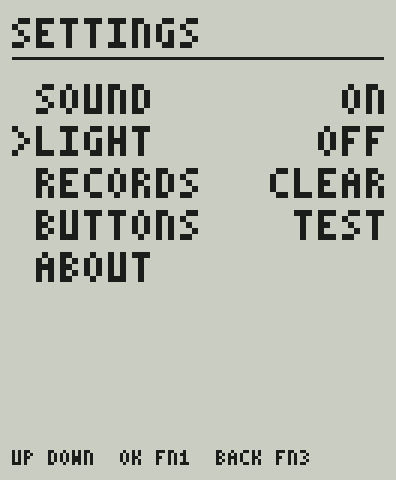
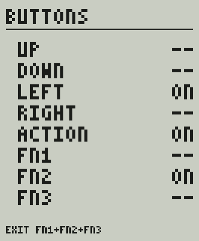
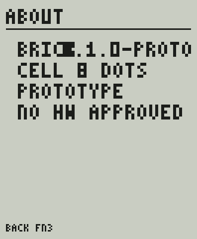

# Меню и управление консоли (прототип)

**Статус:** PROPOSED (ADR-019, ADR-020). Роли функциональных клавиш в PRD **не утверждены** (PRD §8.2: «три подписанных функциональные кнопки, назначение предстоит определить»), поэтому ниже — предложение, а не требование. Картинки — иллюстрации **логического** 1-битного кадра (`tests/golden/*.txt`, сетка 8 точек на клетку, 132×160), раскрашенные скриптом `tools/frames/frames_to_png.py`: чернила тёмные, фон светло-серый (позитивная полярность). Реальные контраст, углы обзора и подсветка панели не моделируются и не проверены.

## 1. Принципы

* Классический вид Brick Game: на матрице 10×20 при включении — **номер/буква игры** крупно, **номер режима** двумя цифрами, **миниатюра** игры внизу; справа — рекорд, SPEED и LEVEL (ADR-016: панель всегда справа, поле не искажается).
* Управление только физическими кнопками корпуса: **D-pad, одна большая ACTION, три функциональные FN1–FN3** (CTRL-01…03). Игра видит только D-pad и ACTION (как «поворот»); FN-клавиши — дело оболочки.
* Никаких цветов, оттенков серого и инверсных (светлое на чёрном) экранов (ADR-003, ADR-015). Выделение — миганием и маркером `>`, а не инверсией.
* Современные функции (настройки, звук, свет, рекорды) — на текстовых страницах той же сетки; не мешают классическому экрану игры.

## 2. Схема экранов

```text
 включение ─▶ ЗАСТАВКА (1 с, любая кнопка пропускает)
                  │
                  ▼
        ┌──────▶ МЕНЮ ◀─────────────────────────────┐
        │   (игра · режим · SPEED · LEVEL)           │ FN3 «назад» (из паузы / конца игры)
        │      │ ACTION / FN1           FN3          │
        │      ▼                         ▼            │
        │    ИГРА ⇄ ПАУЗА            НАСТРОЙКИ ─▶ ТЕСТ КНОПОК (выход: FN1+FN2+FN3)
        │      │                         │       └▶ О ПРИБОРЕ
        │      ▼ конец игры              │ FN3 «назад»
        │   заливка поля → ACTION/FN1: играть снова
        └──────────────────────────────────────────┘
```

## 3. Кнопки

| Кнопка | Меню | Настройки | Игра идёт | Пауза / конец игры |
| --- | --- | --- | --- | --- |
| **ВЛЕВО / ВПРАВО** | предыдущая / следующая **игра** (режим сбрасывается на 01) | изменить значение | сдвиг (передаётся игре) | — |
| **ВВЕРХ / ВНИЗ** | **+1 / −1** к значению в фокусе (режим, SPEED или LEVEL), удержание повторяет | курсор | ВВЕРХ — поворот, ВНИЗ — мягкое падение | — |
| **ACTION** (большая) | старт | действие / изменить | поворот | продолжить / играть снова |
| **FN1** | старт | действие / изменить | пауза | продолжить / играть снова |
| **FN2** | фокус: РЕЖИМ → SPEED → LEVEL | — | **подсветка** (выкл → слабо → сильнее) | подсветка |
| **FN3** | открыть настройки | назад | пауза | назад в меню |

Правила, которые стоит обсудить с владельцем:

1. **Выход из игры — два нажатия FN3.** Первое ставит паузу, второе выходит: случайное нажатие не теряет партию. Классический RESET выходит сразу — это осознанное отличие.
2. **Режим в фокусе пропускается, если у игры один режим** (сейчас у Tetris единственный режим 01): FN2 переключает SPEED и LEVEL.
3. **FN2 меняет смысл:** в меню выбирает фокус, в игре включает подсветку. Это экономит кнопку, но делает клавишу контекстной (риск R-2: проверить эргономику и подписи на корпусе).
4. **Жёсткого сброса и `FIRE` нет:** на корпусе одна кнопка действия (PRD §5).
5. Если нажать ACTION, чтобы продолжить после паузы, это нажатие **не** передаётся игре как поворот.

## 4. Экраны

### Заставка
Все клетки и все сегменты включены на 1 с, как у классических игрушек (заодно показывает «мёртвые» точки на панели). 

### Меню
Раскладка матрицы (клетки): крупный знак игры 4×7 в колонках 4–7, строки 0–6 (два знака — колонки 1–4 и 6–9); номер режима двумя малыми цифрами 3×5 в строках 8–12 (десятки с колонки 2, единицы с колонки 7; «1» — вертикальная черта справа, как на фотографии оригинала); название игры и подпись режима текстом в строках 13–14; миниатюра 10×5 в строках 15–19 (у Tetris — два кадра с падающей «Z», кадр меняется раз в 0,5 с). Справа: рекорд для выбранной игры и режима, SPEED и LEVEL (значения 0…9, игре передаётся значение + 1); значение **в фокусе мигает** (2 Гц).

Меню Tetris (фокус SPEED, рекорд 12345, SPEED 3, LEVEL 1): 

Две игры, у первой три режима; двузначный номер игры «12», фокус на РЕЖИМЕ (мигает «03»): 

(Второй каталог — заглушки `tests/support/stub_game.c`: они доказывают, что меню не привязано к Tetris; в продукт заглушки не входят.)

### Игра
Поле 10×20 слева, панель справа: HI, SCORE (до 7 цифр, без ведущих нулей), NEXT 4×4, SPEED и LEVEL (0…9), значок звука; на паузе — значок паузы.

Игра   Пауза 

Конец игры: поле заливается снизу вверх (127 мс на ряд), затем остаётся залитым, рекорд сохраняется; ACTION или FN1 — играть снова. 

### Настройки, тест кнопок, о приборе
| Пункт | Значения | Хранится |
| --- | --- | --- |
| SOUND | ON / OFF — программное отключение; громкость — физическое колесо, программе не видна | да |
| LIGHT | OFF / LOW / HIGH — запрос уровня подсветки; отображение в яркость — дело драйвера (подсветка и её тип не выбраны) | да |
| RECORDS | CLEAR → SURE? (подтверждение вторым нажатием; уход курсора отменяет) | да |
| BUTTONS | показывает состояние восьми кнопок; **выход — одновременно FN1+FN2+FN3**, чтобы можно было проверить и сами FN | — |
| ABOUT | версия, сетка, «PROTOTYPE · NO HW APPROVED» | — |

  

## 5. Рекорды и профиль

Рекорд хранится на пару «игра + режим» (`uid` игры стабилен и не переиспользуется). Сохраняется при конце игры и при выходе из партии с лучшим счётом, позиция меню и настройки — при изменении. Формат и защита от обрыва питания — [FIRMWARE_ARCHITECTURE.md §8](FIRMWARE_ARCHITECTURE.md).

## 6. Допущения и открытые вопросы

* Раскладка матрицы меню (позиции знака, режима и миниатюры) взята из эталона, где она восстановлена по фотографии экрана (часть цифр нарисована «в том же стиле»). Как листается меню на настоящих устройствах, неизвестно — **допущение эталона**.
* Роли FN1–FN3, подтверждение выхода, быстрая подсветка — предложение (ADR-019); физические надписи кнопок не заданы.
* Шрифт: латиница, 3×5 — читаемость на реальной панели не проверялась; для кириллицы потребуется 5×7.
* Звук меню (клик навигации, подтверждение, назад) — заглушки.
* Нет индикации уровня подсветки на экране, нет индикации заряда и BLE (их источники не выбраны).

## 7. Как проверяется

`tests/unit/test_console.c` — переходы между экранами, навигация, автоповтор, запуск с выбранными параметрами, отображение кнопок в игру, пауза и двухшаговый выход, рекорды (в т.ч. «ниже рекорда — не пишем»), настройки и их сохранение, подтверждение очистки, тест кнопок, подсветка, сбой записи, «кадр отдаётся панели только при изменении». `tests/unit/test_screens.c` сверяет 9 золотых кадров с `tests/golden`; при намеренном изменении экрана: `BK_UPDATE_GOLDEN=1 ctest`, просмотреть diff и обновить `docs/img` (`python3 tools/frames/frames_to_png.py tests/golden/<имя>.txt docs/img/<имя>.png 3`).
