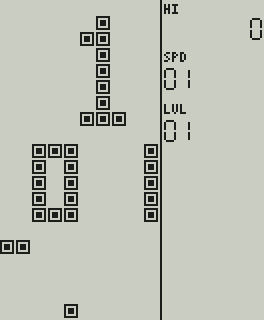
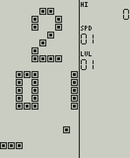
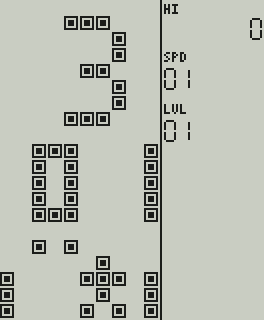
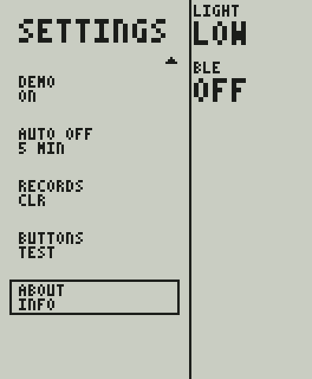
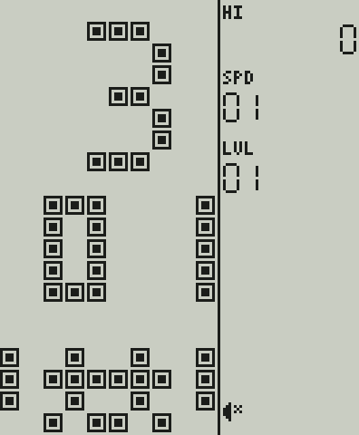

# Меню и управление консоли (прототип)

**Статус:** PROPOSED (ADR-025, ADR-026, ADR-030, ADR-041); **внешний вид меню и анимированное превью игр подтверждены владельцем** (PRD UI-01, ADR-041). Физический набор кнопок **подтверждён** PRD (CTRL-01…03): **четыре отдельные круглые жёлтые кнопки направлений** (не крестовина), **одна большая гладкая ACTION** и **три кнопки MODE / SELECT / START** прямо под LCD. Что именно делает каждая из них — **предложение**: PRD §5 оставляет привязку действий (в т.ч. пауза/назад/сброс) на проверку по играм и эргономике. Список настроек (PRD UI-02) — предложение.

Картинки — иллюстрации **логического** 1-битного кадра (`tests/golden/*.txt`, эталонная сетка 8 точек на клетку, 132×160), раскрашенные скриптом `tools/frames/frames_to_png.py`: чернила тёмные, фон светло-серый (позитивная полярность). Реальные контраст, углы обзора и подсветка панели не моделируются и не проверены. Макеты владельца ([design/renders](../design/renders/README.md)) — иллюстрации замысла, прошивка рисует свой кадр; различия перечислены в §4.6.

## 1. Принципы

* Классический вид Brick Game: на матрице 10×20 при включении — **номер/буква игры** крупно, **номер режима** (варианта игры) двумя цифрами и **зацикленная анимация геймплея** игры внизу; справа — рекорд, SPD и LVL (ADR-016: панель всегда справа, поле не искажается). Раскладка по макету владельца: пустой ряд, знак игры 7 рядов, пустой ряд, номер режима 5 рядов, пустой ряд, анимация 5 рядов (названия игры на матрице нет: игру узнают по знаку и по анимации).
* Управление только физическими кнопками корпуса (PRD CTRL-01…03). Игра видит только четыре направления и ACTION (как «поворот»); кнопки MODE / SELECT / START — дело оболочки.
* Никаких цветов, оттенков серого и инверсных (светлое на чёрном) экранов (ADR-003, ADR-015). Выделение — миганием и рамкой вокруг строки, а не инверсией.
* Современные функции (настройки, звук, свет, рекорды) — на текстовых страницах с той же матрицей и той же статус-колонкой справа; не мешают классическому экрану игры.
* Слово «режим» в меню — вариант игры (как в классических играх «01…»), а кнопка **MODE** — переключатель режима оболочки (меню ↔ настройки ↔ назад); это разные вещи, они названы по-разному в коде (`BK_MENU_MODE` и `BK_BTN_MODE`).
* Анимация не бесплатна: каждая новая картинка — обновление панели (у фаворита `fSCS` 1…10 Гц, AGENTS.md: 60 Гц не предполагать). Клипы нарисованы на 4…6 картинок в секунду, анимацию можно выключить (настройка DEMO), а после времени AUTO OFF без нажатий экран гаснет совсем.

## 2. Схема экранов

```text
 включение ─▶ ЗАСТАВКА (1 с, любая кнопка пропускает)
                  │
                  ▼
        ┌──────▶ МЕНЮ ◀─────────────────────────────┐
        │   (игра · режим · SPD · LVL · клип)        │ MODE «назад» (из паузы / конца игры)
        │      │ ACTION / START         MODE         │
        │      ▼                         ▼            │
        │    ИГРА ⇄ ПАУЗА            НАСТРОЙКИ ─▶ ТЕСТ КНОПОК (выход: MODE+SELECT+START вместе)
        │      │                         │       └▶ О ПРИБОРЕ
        │      ▼ конец игры              │ MODE «назад»
        │   заливка поля → ACTION/START: играть снова
        └──────────────────────────────────────────┘

 любой экран, кроме заставки и идущей игры ── AUTO OFF без нажатий ──▶ СОН (пустой кадр, подсветка выключена)
                                                                          └─ любая кнопка ─▶ тот же экран
```

## 3. Кнопки

| Кнопка | Меню | Настройки | Игра идёт | Пауза / конец игры |
| --- | --- | --- | --- | --- |
| **ВЛЕВО / ВПРАВО** | предыдущая / следующая **игра** (режим сбрасывается на 01, клип начинается с первого кадра); при одной игре ничего не делает и не звучит | изменить значение | сдвиг (передаётся игре) | — |
| **ВВЕРХ / ВНИЗ** | **+1 / −1** к значению в фокусе (режим, SPD или LVL), удержание повторяет | курсор (список прокручивается, чтобы курсор был виден) | ВВЕРХ — поворот, ВНИЗ — мягкое падение | — |
| **ACTION** (большая) | старт | действие / изменить | поворот | продолжить / играть снова |
| **START** | старт | действие / изменить | пауза | продолжить / играть снова |
| **SELECT** | фокус: РЕЖИМ → SPD → LVL | — | **подсветка** (выкл → слабо → сильнее) | подсветка |
| **MODE** | открыть настройки | назад | пауза | назад в меню |

Правила, которые стоит обсудить с владельцем:

1. **Выход из игры — два нажатия MODE.** Первое ставит паузу, второе выходит: случайное нажатие не теряет партию. Классический RESET выходит сразу — это осознанное отличие.
2. **Режим в фокусе пропускается, если у игры один режим.** Варианты игр не делаются (ADR-036): у всех игр первой версии один режим, поэтому SELECT идёт по кругу SPD → LVL; выбор режима остаётся в меню на случай игр с несколькими вариантами (его проверяет тестовая игра с несколькими режимами).
3. **SELECT меняет смысл:** в меню выбирает фокус, в игре включает подсветку. Это экономит кнопку, но делает клавишу контекстной (риск R-2: проверить эргономику и подписи на корпусе).
4. **Жёсткого сброса и `FIRE` нет:** на корпусе одна кнопка действия (PRD §5).
5. Если нажать ACTION, чтобы продолжить после паузы, это нажатие **не** передаётся игре как поворот. Так же нажатие, которое будит погасший экран, **ничего больше не делает** (не стартует игру, не листает меню, не снимает паузу).
6. Четыре направления — отдельные кнопки, разнесённые, чтобы случайно не нажать две сразу (PRD). Игра не запрещает одновременное нажатие и обрабатывает влево/вправо независимо; ложные диагонали — задача механики и теста на людях.

## 4. Экраны

### 4.1 Заставка
Все клетки и все сегменты включены на 1 с, как у классических игрушек (заодно показывает «мёртвые» точки на панели; значок перечёркнутого динамика входит в этот узор). 

### 4.2 Меню и анимированное превью игры
Раскладка матрицы (клетки): пустой ряд 0; знак игры 4×7 в колонках 4–7, ряды 1–7 (два знака — колонки 1–4 и 6–9); номер режима двумя малыми цифрами 3×5 в рядах 9–13 (десятки с колонки 2, единицы с колонки 7; «1» — вертикальная черта справа, как на фотографии оригинала); **клип 10×5 в рядах 15–19**. Справа: рекорд для выбранной игры и режима, SPD и LVL в первых трёх слотах статус-колонки — **всегда двумя цифрами, 01…10** (владелец, как в макете): это ровно то, что получит игра (внутри меню значения хранятся как 0…9, на экране прибавляется единица); значение **в фокусе мигает** (2 Гц).

Меню Tetris (фокус SPD, рекорд 12345, SPD 04, LVL 02; кадр клипа — «постер»): 

Две игры, у первой три режима; двузначный номер игры «12», фокус на РЕЖИМЕ (мигает «03»): 

(Второй каталог — заглушки `tests/support/stub_game.c`: они доказывают, что меню не привязано к Tetris; в продукт заглушки не входят.)

**Клип** (`brick/clip.h`) — **зацикленная анимация геймплея**: константные данные игры, `frame_count` кадров 10×5 клеток, по `frame_ticks` тактов на кадр. Состояния и ГСЧ не нужны, память состояния игры в меню не занята. Анимации (вживую — GIF, 170…250 мс на кадр; лист кадров показывает каждый кадр, подчёркнут «постер»):

| Игра | Что происходит | Кадров, темп, петля | Анимация | Лист кадров |
| --- | --- | --- | --- | --- |
| Tetris | четыре фигуры (O, O, J, L) строят кучу вокруг колодца в две клетки, вертикальная S падает в него, два ряда мигают дважды и сгорают; петля замыкается на единственной оставшейся клетке | 29, 6 карт./с, 4,8 с |  | [clip_tetris.png](img/clip_tetris.png) |
| Snake | червяк из трёх клеток пересекает полосу поля и съедает три мигающих плода (вверху справа, внизу слева, внизу справа), вырастая до шести клеток | 26, 4 карт./с, 6,5 с |  | [clip_snake.png](img/clip_snake.png) |
| Racing | рамка дороги бежит вниз (период 5, петля из 30 кадров без шва), машина слева проезжает мимо, справа едет вторая — игрок в последний момент уходит в свободную полосу и возвращается после неё | 30, 6 карт./с, 5,0 с |  | [clip_racing.png](img/clip_racing.png) |
| Tank | танк игрока слева стреляет в стену из трёх клеток и во вражеский танк справа; снаряды встречаются и гаснут, выстрел через пролом уничтожает врага, второй враг въезжает сверху, поворачивается к игроку и повторяет судьбу первого; стена восстанавливается в точке склейки | 29, 6 карт./с, 4,8 с |  | [clip_tank.png](img/clip_tank.png) |

Клипы **нарисованы для этого проекта** (не спрайты эталона и не запись игры): кадры составлены вручную по правилам игры (Tetris — настоящие фигуры и правила сгорания рядов, Snake — ход по клеткам, Racing — машина 3×4 и шаги дороги как в игре, Tank — настоящие рисунки танков и порядок «стена, снаряд, пролом»), поэтому это иллюстрация геймплея, а не его воспроизведение (R-12). Лист кадров делает `tools/frames/clip_sheet.py` прямо из исходника игры, GIF — `tools/experiments/menu_frames.c` + `tools/frames/menu_gif.py` (нужен Pillow, только для документации).

Правила для клипа новой игры (проверяет `tests/unit/test_clips.c`): не меньше 20 кадров; петля 2…8 с; не больше 10 картинок в секунду (`frame_ticks` ≥ 6) — столько способен обновлять фаворит; в каждом кадре от 1 до 35 зажжённых клеток из 50 (ни пустого, ни залитого); соседние кадры (включая последний → первый) отличаются на 1…24 клетки: ни застоя, ни скачка; кадр-«постер» не меньше пяти клеток. Нет клипа (`preview = NULL`) — область остаётся пустой.

**Настройка DEMO** (по умолчанию ON): OFF — меню показывает один неподвижный кадр («постер» клипа), панель обновляется только для мигающего значения. Это экономит обновления панели (каждая новая картинка — запись в память LCD, ср. R-8, R-9), но влияние на энергопотребление **не измерено**.

### 4.3 Игра и пауза
Поле 10×20 слева, панель справа по макету: HI, SCORE (до 7 цифр, без ведущих нулей), **NEXT 4×4** (у игр с жизнями — **LIFE**: по две клетки на жизнь), SPD и LVL (двумя цифрами, 01…10, настоящие скорость и уровень игры). Значок динамика показывается **только когда звук выключен** (в макете значков нет); значка паузы в панели больше нет.

**Пауза — рамка 6×4 клетки посреди поля со знаком паузы** (две полосы), поле за рамкой очищено, чтобы мигающие клетки не просвечивали. Панель при паузе не меняется (как в макете).

Игра   Пауза   Игра с жизнями (Snake) 

Конец игры: поле заливается снизу вверх (127 мс на ряд), затем остаётся залитым, рекорд сохраняется; ACTION или START — играть снова. 

### 4.4 Настройки
Список по макету: заголовок, пары «название над значением», вокруг выбранной пары **рамка**; справа та же статус-колонка: **LIGHT** и **BLE** (текущее состояние; слота «BK 01» из макета нет — владелец убрал его как бессмысленный). Без нижней подсказки: роли кнопок подписаны на корпусе. Видно пять пунктов; список прокручивается ровно настолько, чтобы курсор оставался в поле зрения, стрелка вверху/внизу показывает, что список продолжается.

| Пункт | Значения | Хранится | Что делает |
| --- | --- | --- | --- |
| SOUND | ON / OFF | да | программное отключение звука; громкость — физическое колесо, программе не видна |
| LIGHT | OFF / LOW / HIGH | да | запрос уровня подсветки; отображение в яркость — дело драйвера (подсветка и её тип не выбраны) |
| BLE | OFF / ON | да (по умолчанию OFF) | запрос радио для связи с телефоном (настройки, синхронизация, PRD BT-01). Только это: звука по Bluetooth нет (BT-02). В прототипе радио нет, значение только хранится и передаётся драйверу через `bk_system_port_t.set_ble` |
| DEMO | ON / OFF | да (по умолчанию ON) | анимированное превью в меню (см. §4.2) |
| AUTO OFF | OFF / 1 / 3 / 5 / 10 MIN | да (по умолчанию 5 MIN) | через это время без нажатий экран гаснет (см. §4.5) |
| RECORDS | CLR → SURE? | да | очистка рекордов: подтверждение вторым нажатием; уход курсора отменяет |
| BUTTONS | TEST | — | страница с состоянием восьми кнопок |
| ABOUT | INFO | — | версия, сетка, «PROTOTYPE · NO HW APPROVED» |

Значения меняют ВЛЕВО/ВПРАВО, ACTION и START (переключатели переключают в любую сторону, у LIGHT и AUTO OFF ВЛЕВО идёт назад).

 Список прокручен до конца: 

**Тест кнопок** показывает состояние восьми кнопок в порядке корпуса ; **выход — одновременно MODE+SELECT+START**, чтобы можно было проверить и сами эти кнопки. **О приборе** — строки без значений.  

Перечёркнутый динамик в статус-колонке (звук выключен): 

### 4.5 Автовыключение экрана (AUTO OFF)
Если в течение выбранного времени нет нажатий, консоль гасит экран: отдаёт панели один пустой кадр и больше ничего (драйвер вправе остановить панель и часы), выключает подсветку (настройка LIGHT сохраняется). Любая кнопка возвращает **тот же экран** и подсветку; сама эта кнопка больше ничего не делает. Нажатая и удерживаемая кнопка — тоже активность. **Идущая игра никогда не считается бездействующей** (дорога едет и без нажатий); игра на паузе или законченная — считается, поэтому забытая на паузе консоль не расходует батарею. Заставка не гасится. Это поведение оболочки: настоящий «сон» микроконтроллера и измерение тока — задача драйвера и стенда (PWR-02).

### 4.6 Что в макетах иначе, чем в прошивке
| Макет владельца | Прошивка | Почему |
| --- | --- | --- |
| Цифры счёта, SPD, LVL гротеском | семисегментные цифры эталонной раскладки (SPD и LVL — двумя цифрами, как в макете) | вид шрифта цифр зависит от панели; шесть цифр счёта вместо семи — отдельный вопрос D-7 |
| Название и значение жирным и обычным начертанием | один шрифт 3×5 одного размера для названия и значения | шрифт 3×5 без жирного начертания; на реальной панели читаемость ещё предстоит проверить |
| Слот «BK 01» в статус-колонке настроек | убран (решение владельца): на страницах справа только LIGHT и BLE | в макете «BK 01» не расшифровывался и не нужен |
| Пять пунктов: SOUND, LIGHT, RECORDS, BUTTONS, ABOUT | восемь: добавлены BLE, DEMO, AUTO OFF | «предусмотри нужные настройки» (PRD UI-02): первые два нужны статус-колонке и анимации, третий — цели 20–30 часов |
| В меню нет названия игры | нет (как в макете); подписи режима тоже нет | игру определяют знак и клип; названия остаются в данных игры (`title`) |

## 5. Рекорды и профиль

Рекорд хранится на пару «игра + режим» (`uid` игры стабилен и не переиспользуется). Сохраняется при конце игры и при выходе из партии с лучшим счётом, позиция меню и настройки — при изменении. Профиль версии 2 хранит ещё BLE, DEMO и AUTO OFF; профиль версии 1 (первая прошивка) читается, три новые настройки получают значения по умолчанию, пишется всегда версия 2. Формат и защита от обрыва питания — [FIRMWARE_ARCHITECTURE.md §8](FIRMWARE_ARCHITECTURE.md).

## 6. Подгонка под физическую панель

Эталонная сетка (16,5 × 20 клеток, панель статуса 6,5 клетки) — **проектная**, а не панель. Реальные кандидаты ([DISPLAY_CANDIDATES.md](DISPLAY_CANDIDATES.md)) дают другую геометрию: у фаворита статус-колонка справа всего ~2,9 клетки. Компоновщик умеет **подгоняться под нативный размер** (`bk_layout_fit`): берёт наибольшую целую клетку, при которой поле 10×20 помещается, всё оставшееся справа отдаёт статус-колонке, центрирует поле по вертикали, уменьшает NEXT и пересчитывает цифры и подписи. Текстовые страницы подгоняются так же: размер текста выбирается так, чтобы самая широкая строка влезла в поле, список всегда показывает пять пар.

Размеры считает `tools/experiments/panel_fit.c` из паспортных данных `DISPLAY_CANDIDATES.md` (активная область и число пикселей). Это **арифметика, а не проверка читаемости**:

| Панель (портретная установка) | Клетка | Клетка, мм | Статус-колонка | Колонка, мм | Цифра, мм (ш × в) | Подпись, мм | NEXT |
| --- | ---: | ---: | ---: | ---: | --- | ---: | --- |
| Sharp LS032B7DD02 3.16″, 336×536 | 26 | 3,30 | 76 | 9,7 | 1,02 × 1,91 | 1,91 | 64 точки |
| Sharp LS044Q7DH01 4.4″, 240×320 (повёрнут) | 16 | 4,48 | 80 | 22,4 | 2,52 × 4,76 | 2,80 | 64 точки |
| Sharp LS027B7DH01 2.7″, 240×400 (повёрнут) | 20 | 2,94 | 40 | 5,9 | 0,44 × 0,73 | 0,73 | 28 точек |

* **3.16″ (фаворит):** клетка 3,3 мм — хорошо; семь цифр счёта по 1,0 × 1,9 мм в колонке 9,7 мм — **на грани читаемости** (проверять на образце при обычном освещении и при подсветке; возможные меры: шесть цифр вместо семи — решение владельца, ведь предел счёта унаследован от эталона, либо крупнее цифры за счёт меньшей клетки). Подписи SPD, LVL, LIFE короче прежних SPEED, LEVEL — для узкой колонки это плюс; значения BLE и LIGHT на страницах настроек — текст в колонке 9,7 мм.
* **4.4″:** статус-колонка 22,4 мм, цифры 2,5 × 4,8 мм — комфортно, но корпус может выйти заметно больше (DISPLAY_CANDIDATES.md).
* **2.7″:** цифры 0,44 × 0,73 мм физически нечитаемы; `BK_MIN_STATUS_DOTS` — геометрический минимум, а не гарантия читаемости. Подтверждает вывод DISPLAY_CANDIDATES.md.

Кадры на этих панелях (по одному хэшу на кадр в `tests/golden/fit.hashes`, картинки — для обзора): 3.16″ меню  и игра ; 4.4″ ; 2.7″ .

## 7. Частота показа

Игровой такт — 60 Гц (правила эталона привязаны к нему), **частота обновления панели — отдельное свойство драйвера**: у фаворита LS032B7DD02 в документации `fSCS` 1…10 Гц, и AGENTS.md требует не предполагать 60 Гц. Порт дисплея HAL имеет поле `max_fps`; консоль не отдаёт кадры чаще, пропускает промежуточные и всегда показывает **последний** кадр, как только интервал истёк; симуляция при этом идёт со своей частотой. Проверено тестом на 10/15/20/30/60 кадров/с и «без ограничения».

Меню тоже подчиняется этому: клипы идут со скоростью 4…6 картинок в секунду, что не больше 10 Гц; мигание значения в фокусе (2 Гц) добавляет свои переключения. Статичная страница (настройки) и погасший экран не стоят ни одного обновления.

Что это значит для игры (**расчёт по таблице скоростей, не измерение на панели**): шагов гравитации в секунду на скоростях 1…10 — 2,25 · 2,81 · 3,37 · 4,11 · 5,62 · 8,22 · 9,63 · 10,87 · 12,48 · 13,48. При 10 кадрах/с на скоростях 8–10 фигура за кадр проходит больше одной клетки, а повтор сдвига при удержании (1 клетка за такт) и мягкое падение (1 клетка за такт) дают до 6 клеток за кадр. Играбельность при 10/15/20/30 Гц надо проверять на настоящем модуле (гейт «КРИТИЧНЫЙ РИСК ПО FPS» в DISPLAY_CANDIDATES.md); воспроизводимая нагрузка для этого — записанные трассы ввода из `tests/fixtures`.

## 8. Допущения и открытые вопросы

* Раскладка матрицы меню (позиции знака, режима) взята из эталона, где она восстановлена по фотографии экрана (часть цифр нарисована «в том же стиле»), сдвинута по макету владельца (знак с ряда 1, режим с ряда 9). Как листается меню на настоящих устройствах, неизвестно — **допущение эталона**.
* Назначение MODE / SELECT / START, подтверждение выхода, быстрая подсветка — предложение (ADR-025); надписи кнопок на корпусе подтверждены PRD, их порядок слева направо MODE · SELECT · START.
* Клипы — рисованная иллюстрация, не запись игры (R-12); читаемость пяти рядов на настоящей панели и приятность анимации при 4–6 Гц проверить глазами на образце.
* Шрифт: латиница, 3×5 (масштабируется целым коэффициентом) — читаемость на реальной панели не проверялась; для кириллицы потребуется 5×7.
* Число цифр счёта (7 по эталону) — на узкой колонке возможно сократить до 6; решение владельца.
* Звук меню (клик навигации, подтверждение, назад) — заглушки.
* Нет индикации заряда (источник не выбран); состояние BLE показывает только запрос (OFF/ON), а не связь: радио в прототипе нет. Слот «BK 01» макета убран по решению владельца.
* AUTO OFF гасит экран, но не усыпляет процессор: ток сна и время просыпания — задача платы; значения 1/3/5/10 минут — предложение, не проверенное на людях и в батарейном бюджете.

## 9. Как проверяется

`tests/unit/test_console.c` — переходы между экранами, навигация, автоповтор, запуск с выбранными параметрами, отображение кнопок в игру, пауза и двухшаговый выход, рекорды (в т.ч. «ниже рекорда — не пишем»), настройки и их сохранение (в т.ч. BLE, DEMO, AUTO OFF и применение BLE при старте), прокрутка списка, подтверждение очистки, тест кнопок (каждая кнопка зажигает свою строку), подсветка, сбой записи, «кадр отдаётся панели только при изменении и не чаще `max_fps`», **статус показывает настоящие скорость и уровень игры двумя цифрами, клип идёт по тактам, с DEMO OFF стоит «постер», AUTO OFF гасит и будит, идущая игра не гасится, забытая пауза гасится, погасшая панель не получает кадров**. `tests/unit/test_render.c` — геометрия, квадратные клетки, подгонка под три панели, рамка паузы, панель меню, метка LIFE, значок динамика, страницы на всех сетках и панелях. `tests/unit/test_clips.c` — проигрыватель и правила клипов у всех игр каталога. `tests/unit/test_save.c` — профиль версии 2 и чтение версии 1. `tests/unit/test_screens.c` сверяет 17 золотых кадров с `tests/golden` (Tetris, Snake, Racing, меню, настройки в двух положениях, тест кнопок, о приборе, заставка) и 6 хэшей кадров на панелях-кандидатах; при намеренном изменении экрана: `BK_UPDATE_GOLDEN=1 ctest`, просмотреть diff и обновить `docs/img` (`python3 tools/frames/frames_to_png.py tests/golden/<имя>.txt docs/img/<имя>.png 3`). Мутационная проверка новой логики меню: 22 внесённых ошибки из 22 пойманы ([CONFORMANCE.md §5](CONFORMANCE.md)).
