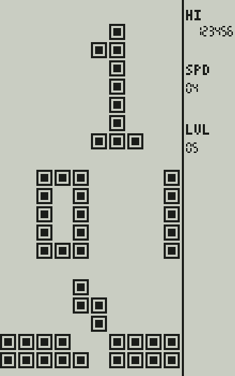
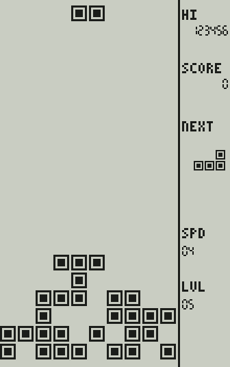
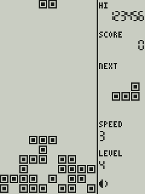
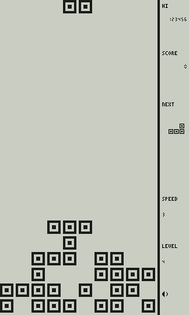

# Меню и управление консоли (прототип)

**Статус:** PROPOSED (ADR-025, ADR-026, ADR-030). Физический набор кнопок **подтверждён** PRD (CTRL-01…03): **четыре отдельные круглые жёлтые кнопки направлений** (не крестовина), **одна большая гладкая ACTION** и **три кнопки MODE / SELECT / START** прямо под LCD. Что именно делает каждая из них — **предложение**: PRD §5 оставляет привязку действий (в т.ч. пауза/назад/сброс) на проверку по играм и эргономике.

Картинки — иллюстрации **логического** 1-битного кадра (`tests/golden/*.txt`, эталонная сетка 8 точек на клетку, 132×160), раскрашенные скриптом `tools/frames/frames_to_png.py`: чернила тёмные, фон светло-серый (позитивная полярность). Реальные контраст, углы обзора и подсветка панели не моделируются и не проверены.

## 1. Принципы

* Классический вид Brick Game: на матрице 10×20 при включении — **номер/буква игры** крупно, **номер режима** (варианта игры) двумя цифрами, **миниатюра** игры внизу; справа — рекорд, SPEED и LEVEL (ADR-016: панель всегда справа, поле не искажается).
* Управление только физическими кнопками корпуса (PRD CTRL-01…03). Игра видит только четыре направления и ACTION (как «поворот»); кнопки MODE / SELECT / START — дело оболочки.
* Никаких цветов, оттенков серого и инверсных (светлое на чёрном) экранов (ADR-003, ADR-015). Выделение — миганием и маркером `>`, а не инверсией.
* Современные функции (настройки, звук, свет, рекорды) — на текстовых страницах той же сетки; не мешают классическому экрану игры.
* Слово «режим» в меню — вариант игры (как в классических играх «01…»), а кнопка **MODE** — переключатель режима оболочки (меню ↔ настройки ↔ назад); это разные вещи, они названы по-разному в коде (`BK_MENU_MODE` и `BK_BTN_MODE`).

## 2. Схема экранов

```text
 включение ─▶ ЗАСТАВКА (1 с, любая кнопка пропускает)
                  │
                  ▼
        ┌──────▶ МЕНЮ ◀─────────────────────────────┐
        │   (игра · режим · SPEED · LEVEL)           │ MODE «назад» (из паузы / конца игры)
        │      │ ACTION / START         MODE         │
        │      ▼                         ▼            │
        │    ИГРА ⇄ ПАУЗА            НАСТРОЙКИ ─▶ ТЕСТ КНОПОК (выход: MODE+SELECT+START вместе)
        │      │                         │       └▶ О ПРИБОРЕ
        │      ▼ конец игры              │ MODE «назад»
        │   заливка поля → ACTION/START: играть снова
        └──────────────────────────────────────────┘
```

## 3. Кнопки

| Кнопка | Меню | Настройки | Игра идёт | Пауза / конец игры |
| --- | --- | --- | --- | --- |
| **ВЛЕВО / ВПРАВО** | предыдущая / следующая **игра** (режим сбрасывается на 01); при одной игре ничего не делает и не звучит | изменить значение | сдвиг (передаётся игре) | — |
| **ВВЕРХ / ВНИЗ** | **+1 / −1** к значению в фокусе (режим, SPEED или LEVEL), удержание повторяет | курсор | ВВЕРХ — поворот, ВНИЗ — мягкое падение | — |
| **ACTION** (большая) | старт | действие / изменить | поворот | продолжить / играть снова |
| **START** | старт | действие / изменить | пауза | продолжить / играть снова |
| **SELECT** | фокус: РЕЖИМ → SPEED → LEVEL | — | **подсветка** (выкл → слабо → сильнее) | подсветка |
| **MODE** | открыть настройки | назад | пауза | назад в меню |

Правила, которые стоит обсудить с владельцем:

1. **Выход из игры — два нажатия MODE.** Первое ставит паузу, второе выходит: случайное нажатие не теряет партию. Классический RESET выходит сразу — это осознанное отличие.
2. **Режим в фокусе пропускается, если у игры один режим** (у Tetris единственный режим 01): SELECT переключает SPEED и LEVEL. Варианты игр не делаются (ADR-036): у всех игр первой версии один режим, поэтому SELECT идёт по кругу SPEED → LEVEL; выбор режима остаётся в меню на случай игр с несколькими вариантами (его проверяет тестовая игра с несколькими режимами).
3. **SELECT меняет смысл:** в меню выбирает фокус, в игре включает подсветку. Это экономит кнопку, но делает клавишу контекстной (риск R-2: проверить эргономику и подписи на корпусе).
4. **Жёсткого сброса и `FIRE` нет:** на корпусе одна кнопка действия (PRD §5).
5. Если нажать ACTION, чтобы продолжить после паузы, это нажатие **не** передаётся игре как поворот.
6. Четыре направления — отдельные кнопки, разнесённые, чтобы случайно не нажать две сразу (PRD). Игра не запрещает одновременное нажатие и обрабатывает влево/вправо независимо; ложные диагонали — задача механики и теста на людях.

## 4. Экраны

### Заставка
Все клетки и все сегменты включены на 1 с, как у классических игрушек (заодно показывает «мёртвые» точки на панели). 

### Меню
Раскладка матрицы (клетки): крупный знак игры 4×7 в колонках 4–7, строки 0–6 (два знака — колонки 1–4 и 6–9); номер режима двумя малыми цифрами 3×5 в строках 8–12 (десятки с колонки 2, единицы с колонки 7; «1» — вертикальная черта справа, как на фотографии оригинала); название игры и подпись режима текстом в строках 13–14; миниатюра 10×5 в строках 15–19 (у Tetris — два кадра с падающей «Z», кадр меняется раз в 0,5 с). Справа: рекорд для выбранной игры и режима, SPEED и LEVEL (значения 0…9, игре передаётся значение + 1); значение **в фокусе мигает** (2 Гц).

Меню Tetris (фокус SPEED, рекорд 12345, SPEED 3, LEVEL 1): 

Две игры, у первой три режима; двузначный номер игры «12», фокус на РЕЖИМЕ (мигает «03»): 

(Второй каталог — заглушки `tests/support/stub_game.c`: они доказывают, что меню не привязано к Tetris; в продукт заглушки не входят.)

### Игра
Поле 10×20 слева, панель справа: HI, SCORE (до 7 цифр, без ведущих нулей), NEXT 4×4, SPEED и LEVEL (0…9), значок звука; на паузе — значок паузы.

Игра   Пауза 

Конец игры: поле заливается снизу вверх (127 мс на ряд), затем остаётся залитым, рекорд сохраняется; ACTION или START — играть снова. 

### Настройки, тест кнопок, о приборе
| Пункт | Значения | Хранится |
| --- | --- | --- |
| SOUND | ON / OFF — программное отключение; громкость — физическое колесо, программе не видна | да |
| LIGHT | OFF / LOW / HIGH — запрос уровня подсветки; отображение в яркость — дело драйвера (подсветка и её тип не выбраны) | да |
| RECORDS | CLEAR → SURE? (подтверждение вторым нажатием; уход курсора отменяет) | да |
| BUTTONS | показывает состояние восьми кнопок в порядке корпуса; **выход — одновременно MODE+SELECT+START**, чтобы можно было проверить и сами эти кнопки | — |
| ABOUT | версия, сетка, «PROTOTYPE · NO HW APPROVED» | — |

  

## 5. Рекорды и профиль

Рекорд хранится на пару «игра + режим» (`uid` игры стабилен и не переиспользуется). Сохраняется при конце игры и при выходе из партии с лучшим счётом, позиция меню и настройки — при изменении. Формат и защита от обрыва питания — [FIRMWARE_ARCHITECTURE.md §8](FIRMWARE_ARCHITECTURE.md).

## 6. Подгонка под физическую панель

Эталонная сетка (16,5 × 20 клеток, панель статуса 6,5 клетки) — **проектная**, а не панель. Реальные кандидаты ([DISPLAY_CANDIDATES.md](DISPLAY_CANDIDATES.md)) дают другую геометрию: у фаворита статус-колонка справа всего ~2,9 клетки. Компоновщик умеет **подгоняться под нативный размер** (`bk_layout_fit`): берёт наибольшую целую клетку, при которой поле 10×20 помещается, всё оставшееся справа отдаёт статус-колонке, центрирует поле по вертикали, уменьшает NEXT и пересчитывает цифры и подписи. Сетка 8 точек при этом не меняется (golden-кадры совпадают пиксель в пиксель до и после обобщения).

Размеры считает `tools/experiments/panel_fit.c` из паспортных данных `DISPLAY_CANDIDATES.md` (активная область и число пикселей). Это **арифметика, а не проверка читаемости**:

| Панель (портретная установка) | Клетка | Клетка, мм | Статус-колонка | Колонка, мм | Цифра, мм (ш × в) | Подпись, мм | NEXT |
| --- | ---: | ---: | ---: | ---: | --- | ---: | --- |
| Sharp LS032B7DD02 3.16″, 336×536 | 26 | 3,30 | 76 | 9,7 | 1,02 × 1,91 | 1,91 | 64 точки |
| Sharp LS044Q7DH01 4.4″, 240×320 (повёрнут) | 16 | 4,48 | 80 | 22,4 | 2,52 × 4,76 | 2,80 | 64 точки |
| Sharp LS027B7DH01 2.7″, 240×400 (повёрнут) | 20 | 2,94 | 40 | 5,9 | 0,44 × 0,73 | 0,73 | 28 точек |

* **3.16″ (фаворит):** клетка 3,3 мм — хорошо; семь цифр счёта по 1,0 × 1,9 мм в колонке 9,7 мм — **на грани читаемости** (проверять на образце при обычном освещении и при подсветке; возможные меры: шесть цифр вместо семи — решение владельца, ведь предел счёта унаследован от эталона, либо крупнее цифры за счёт меньшей клетки).
* **4.4″:** статус-колонка 22,4 мм, цифры 2,5 × 4,8 мм — комфортно, но корпус может выйти заметно больше (DISPLAY_CANDIDATES.md).
* **2.7″:** цифры 0,44 × 0,73 мм физически нечитаемы; `BK_MIN_STATUS_DOTS` — геометрический минимум, а не гарантия читаемости. Подтверждает вывод DISPLAY_CANDIDATES.md.

Кадры на этих панелях (по одному хэшу на кадр в `tests/golden/fit.hashes`, картинки — для обзора): 3.16″ меню  и игра ; 4.4″ ; 2.7″ .

## 7. Частота показа

Игровой такт — 60 Гц (правила эталона привязаны к нему), **частота обновления панели — отдельное свойство драйвера**: у фаворита LS032B7DD02 в документации `fSCS` 1…10 Гц, и AGENTS.md требует не предполагать 60 Гц. Порт дисплея HAL имеет поле `max_fps`; консоль не отдаёт кадры чаще, пропускает промежуточные и всегда показывает **последний** кадр, как только интервал истёк; симуляция при этом идёт со своей частотой. Проверено тестом на 10/15/20/30/60 кадров/с и «без ограничения».

Что это значит для игры (**расчёт по таблице скоростей, не измерение на панели**): шагов гравитации в секунду на скоростях 1…10 — 2,25 · 2,81 · 3,37 · 4,11 · 5,62 · 8,22 · 9,63 · 10,87 · 12,48 · 13,48. При 10 кадрах/с на скоростях 8–10 фигура за кадр проходит больше одной клетки, а повтор сдвига при удержании (1 клетка за такт) и мягкое падение (1 клетка за такт) дают до 6 клеток за кадр. Играбельность при 10/15/20/30 Гц надо проверять на настоящем модуле (гейт «КРИТИЧНЫЙ РИСК ПО FPS» в DISPLAY_CANDIDATES.md); воспроизводимая нагрузка для этого — записанные трассы ввода из `tests/fixtures`.

## 8. Допущения и открытые вопросы

* Раскладка матрицы меню (позиции знака, режима и миниатюры) взята из эталона, где она восстановлена по фотографии экрана (часть цифр нарисована «в том же стиле»). Как листается меню на настоящих устройствах, неизвестно — **допущение эталона**.
* Назначение MODE / SELECT / START, подтверждение выхода, быстрая подсветка — предложение (ADR-025); надписи кнопок на корпусе подтверждены PRD, их порядок слева направо MODE · SELECT · START.
* Шрифт: латиница, 3×5 (масштабируется целым коэффициентом) — читаемость на реальной панели не проверялась; для кириллицы потребуется 5×7.
* Число цифр счёта (7 по эталону) — на узкой колонке возможно сократить до 6; решение владельца.
* Звук меню (клик навигации, подтверждение, назад) — заглушки.
* Нет индикации уровня подсветки на экране, нет индикации заряда и BLE (их источники не выбраны).

## 9. Как проверяется

`tests/unit/test_console.c` — переходы между экранами, навигация, автоповтор, запуск с выбранными параметрами, отображение кнопок в игру, пауза и двухшаговый выход, рекорды (в т.ч. «ниже рекорда — не пишем»), настройки и их сохранение, подтверждение очистки, тест кнопок (каждая кнопка зажигает свою строку), подсветка, сбой записи, «кадр отдаётся панели только при изменении и не чаще `max_fps`». `tests/unit/test_render.c` — геометрия, квадратные клетки, подгонка под три панели. `tests/unit/test_screens.c` сверяет 12 золотых кадров с `tests/golden` (Tetris, Snake и сцена очистки Snake, меню, настройки, тест кнопок, заставка) и 6 хэшей кадров на панелях-кандидатах; при намеренном изменении экрана: `BK_UPDATE_GOLDEN=1 ctest`, просмотреть diff и обновить `docs/img` (`python3 tools/frames/frames_to_png.py tests/golden/<имя>.txt docs/img/<имя>.png 3`).
